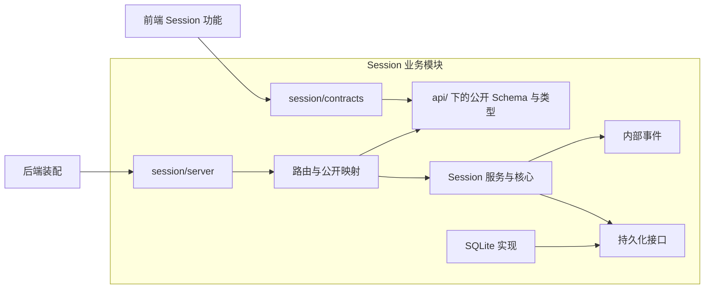

# Design

## Context

动机与范围见 proposal.md。任务 1.1–1.4 已建立前后端、共享协议与同步 SQLite SessionStore；模型循环尚未实现。Session 参考基线为 DSH 已提交版本 `d347e703908d0406b7a7ef80e3a0e594d86b2215` 的 `packages/core/session`、`packages/session/session-persistence`、`session-persistence-jsonl` 和 `session-checkpoint-policy`。参考仓库 Session index/types 的未提交修改不自动纳入基线。对齐对象是 Session 的数据、接口和行为，持久化介质改为 SQLite，装配改为普通 TypeScript 与 emit；不是复刻 DSH 全部插件和业务功能。

## Goals / Non-Goals

**Goals:** 对齐 DSH 的追加日志、历史派生、请求重建、fork、存储 handle、写入所有权和崩溃修复，提供显式 `session.flush()` 检查点；保持连接、Turn、工具操作和会话事实独立，验证审批前不执行、模拟工具幂等及超时结算。

**Non-Goals:** 不引入 Cordis、动态插件加载、serial/waterfall 调用链或 JSONL 编码与历史格式迁移。不保证任意外部工具恰好执行一次，不推断语义相同调用必定是同一操作，不实现等待核实、迟到结果结算、自动重试或跨进程续跑。保留 DSH 的结算后紧凑流记录，不承诺硬崩溃前未结算 token 的恢复或原始网络包回放。权限体系后置，审批不替代身份授权。

## Decisions

### 1. 固定装配与职责分离

第一版使用 Node.js 24 和 pnpm 10 workspace，所有工作区包采用 TypeScript 严格类型检查。

| 工作区 | 技术与职责 |
| --- | --- |
| `apps/web` | React 与 Vite，负责页面、前端 Session 和 `follow` 帧消费。 |
| `apps/server` | Fastify 5 应用启动与固定装配，组合业务模块，并维护 Agent 执行、模型适配和工具治理。 |
| `packages/session` | Session 业务模块，维护会话核心、持久化能力和 Session API；通过独立入口向浏览器暴露公开契约，向后端暴露服务端能力。目标架构移除 `packages/protocol`。 |
| `apps/mock-mcp` | 工具接入阶段加入的本地模拟 MCP 服务，独立启动，用于验证工具调用、超时及幂等。 |

后端启动入口固定装配 SessionStore、SessionPersistence、AgentManager、Model Adapter、工具批次调度器、工具执行服务、ApprovalService 与 MCP Client。SessionStore 管理内存 Session，Session 持有不可变日志和派生缓存；AgentManager 管理每会话 ReActAgent 及写 handle 的释放权。ReActAgent 驱动 Turn/Step，协调输入、活跃草稿和订阅顺序。工具执行服务负责参数与结果校验、策略和正文，审批服务负责等待及返回审批决定，批次调度器负责派发顺序和配对结果写日志。HTTP/SSE 负责请求与连接，网络等待在会话提交串行区外执行。

事件连接只提供类型化 `on/emit`：监听器同步接收通知，不通过返回值控制流程，不等待异步监听器。注册返回取消订阅函数；emit 按本次派发开始时的监听器快照顺序调用，单个监听器异常独立报告，不阻断其余监听器或撤销已接受事件。持久化监听器同步复制事件并入缓冲，异步数据库错误在 flush 时报告。Session.append 的日志接受与发布过程禁止重入。初始化先绑定持久化再开放生产；关闭先停止生产、排空缓冲、解除监听，再释放 handle 所有权和数据库资源。

本地在仓库根目录运行 `pnpm dev` 启动 Web 和后端。Vite 将 `/api` 下的 HTTP 和 SSE 请求转发到本地 Fastify。模拟 Provider 在后端进程内作为 Model Adapter 装配，模拟 MCP 服务按工具验收需要另行启动。

```text
React --> HTTP / SSE --> AgentManager --> ReActAgent
                              |              |
                              v              +--> Model Adapter --> Provider
                       Session / Event Log   |
                              |              +--> Tool Scheduler --> Tool Service --> Tools
                         emit |                     |
                              v                     | await session.flush()
                    SessionPersistence <------------+
                              |
                         SQLite Handle
```

监听派发分离 Session 与数据库实现，关键动作直接 await 显式方法，不以 emit 成功代替持久化、审批或执行许可。第一版串行执行工具；模型一次返回多个调用时逐个处理，前一调用导致本轮终止则后续调用不调度。

#### 1.1 会话级 Agent 生命周期与消息接受

同一已加载 Session 对应一个 ReActAgent，跨多个 Turn 存活。AgentManager 按 sessionId 管理实例并合并并发加载，取得写 handle、读取日志并完成必要修复后才发布实例。创建空会话仅保存并 flush header，不创建 Agent；首次提交消息按需加载。历史查询和 SSE 只观察，不创建 Agent、不启动模型请求。Agent 的 `idle`、`running` 和压缩阶段引入的 `maintenance` 是进程运行状态。Turn 的成功、失败、取消、中断分别由持久记录表达。

Turn 完成回到 idle，浏览器断线不销毁 Agent。AgentManager 显式关闭时先拒绝新输入、取消当前活动并等待驱动退出，再排空并关闭 handle、解绑和移除实例。空闲 Agent 继续持有写入权，不在每个 Turn 结束时释放；初期省略自动空闲回收、inbox、steering 和自动后台维护调度。

浏览器首次发送时生成 `requestId`，与 `text` 一起提交。重试同一次发送复用原编号和原文，主动再发一条消息使用新编号。后端在会话串行区内先按 `(sessionId, requestId)` 查询已提交记录。命中且正文与校验后保存的正文一致时，返回 `200 {sessionId, turnId}`，即使原 Turn 已结束；正文不同时返回 `409 submission_conflict`。`200` 确认原提交已落盘，执行状态由历史和 SSE 提供，重复请求不创建或重新调度 Turn。

首次接受时，已有活动 Turn 则返回 `409 turn_active`，等待审批及取消尚未结算均算活动。拒绝时不保存编号或消息，也不排队。会话空闲时，完成 Agent 加载与所有权取得后，按 §2.2 原子提交编号、用户消息与 Turn 开始事件。提交成功后才发布到 Session 并接管调度，之后返回 `202 {sessionId, turnId}`，无需等待 Provider 响应。确认事务未提交时返回未接受，存储恢复和后台排空也不会启动原 Turn。

事务已提交后，持久日志是接受事实的依据。提交后内存发布或调度交接失败时，若连接仍可响应，返回 `200 {sessionId, turnId}` 确认已提交。后端从持久前缀恢复会话，无法安全接管的 Turn 按故障路径结算，崩溃遗留的 Turn 按中断修复。历史和 SSE 提供执行结局。

若提交结果暂时未知，关闭该会话的新任务和外部效果准入。先确认原事务已终止，再按 `(sessionId, requestId)` 核对可靠的持久记录。若发送响应时仍不能确认，返回 `503 {code: "submission_pending"}`。同编号重发在未核对前也返回待确认，不再次写入或调度。确认回滚时返回 `503 {code: "submission_not_accepted"}`，释放本次暂存，恢复后可以按原编号重试。客户端遇到响应丢失或待确认响应时保留本次编号和正文。

取消入口为 `POST /api/sessions/:sessionId/turns/:turnId/cancel`，只作用于指定活动 Turn。成功表达已接受取消请求，不保证已经终态；重复取消不产生额外效果，旧 Turn 的迟到请求不能取消新 Turn。最终结算由历史与 SSE 确认。具体取消响应状态码及错误字段留待 HTTP 协议讨论，不在本轮补定。

#### 1.2 标识来源

sessionId、turnId、stepId、attemptId 由后端生成，消息提交的 requestId 由客户端生成并在所属 Session 内使用。callId 保留模型返回值，在所属 Step 内关联，不单独作为全局键。参数校验后由后端生成 operationId，绑定工具、版本与不可变参数。前端引用后端已返回标识，模型不得指定 operationId；调度和历史重建始终携带所属 Session/Turn/Step，避免跨会话或跨 Step 误配。

#### 1.3 业务模块拥有契约与预期组织

目标架构放弃中央 `packages/protocol`，不以另一个跨业务 `contracts` 或全局 `types` 包替代。契约由决定其语义的业务模块维护，定义位置、复用范围和公共入口分别设计。以下图与目录是预期组织，不表示现有代码已经迁移；Context 和任务 1.1–1.4 中的共享协议描述保留为已有实现的历史记录。本次记录设计，不据此勾选实现任务；代码迁移时需同步相关规范、任务、消费者及 README。



箭头表示模块依赖，不表示 HTTP 数据流或运行时调用顺序。前端通过 HTTP/SSE 调用服务端业务接口；浏览器仅依赖契约入口。此图聚焦 Session 的定义归属与入口边界，Agent、模型、工具和审批的执行职责仍见 §1 的运行链路及后续章节。

```text
apps/
  server/src/
    index.ts                     启动与关闭
    app.ts                       固定装配、注册业务路由
    agent/
      agent-manager.ts           Agent 实例与生命周期
      react-agent.ts             执行循环
    model/
      adapter.ts                 模型接入接口及相关参数、结果
      providers/                 具体模型接入
  web/src/features/session/
    session-api.ts               HTTP 调用与响应解析
    session-stream.ts            SSE 消费与重连
    session-state.ts             页面状态、草稿与发送占位
    components/                  会话界面
packages/
  session/src/
    api/
      submission.ts              消息提交请求、响应 Schema 与类型
      history.ts                 公开历史记录与查询结果
      follow.ts                  SSE 业务帧
      contracts.ts               选择性导出浏览器可用契约
      routes.ts                  Session 路由注册
      public-record.ts           内部日志到公开记录的映射
    session.ts                   Session 行为及相关参数、结果
    events.ts                    内部持久事件及边界校验
    service.ts                   创建、提交等会话用例
    persistence.ts               持久化接口及相关参数、结果
    storage/sqlite.ts            SQLite 实现及专有结构
    server.ts                    服务端公共入口
```

目录展示关键职责，不是完整文件清单或必须逐项创建的模板。单文件内部状态留在实现文件；功能参数与结果默认与功能共置。形成独立主题或出现独立消费者后再拆分，不按类型数量或文件长度机械建目录。

| 定义 | 所有者与位置 | 消费方式 |
| --- | --- | --- |
| 消息提交请求、响应 | Session API 的 `api/submission.ts` | 运行时边界用 Zod 4 定义并用 `z.infer` 推导类型；路由和浏览器共用。 |
| 公开历史记录 | Session API 的 `api/history.ts` | 历史查询与 `api/follow.ts` 共用，不能充当内部事件定义来源。 |
| SSE 业务帧 | Session API 的 `api/follow.ts` | 服务端发布与浏览器消费共用。 |
| 内部 Session 事件 | `events.ts` | 日志、派生和持久化使用；公开映射按需要转换。 |
| Session 操作选项与结果 | 默认共置于 `session.ts` 或使用它的功能文件 | 已校验的进程内结构直接用 TypeScript 类型。 |
| SessionPersistence、SessionHandle 及相关约定 | `persistence.ts` | 由会话能力定义，调用方与 SQLite 实现共同遵守。 |
| SQLite 行结构与事务辅助类型 | `storage/sqlite.ts` | 不上提到公共契约。 |
| Agent 活动状态与取消资源 | 使用它的 Agent 实现文件 | 不作为浏览器可传输对象。 |
| 发送占位、订阅代次与草稿状态 | 前端对应功能文件 | 不进入后端持久契约。 |

前端从 `@mharness/session/contracts` 导入公开 Schema 与类型，后端装配从 `@mharness/session/server` 导入服务端能力，模块内部直接相对导入具体功能文件。`api/contracts.ts` 只选择性导出，定义保留在所属功能文件。内部存在类型文件不自动产生 `/types` 公共入口；纯类型依赖使用 `import type`、`export type`。`types.ts` 默认承载纯类型声明，运行时解析和校验留在具体功能模块。

浏览器契约入口的完整运行时与类型依赖链均不能引入 Fastify、SQLite、Node.js 资源或服务端实现；仅使用 `import type` 不足以保证隔离。包的 `exports`、依赖声明和编译配置应与这两个入口一致。Session 核心不依赖其 API 层，内部事件不从公开记录反向推导；表示与语义相同时可复用稳定数据定义，出现字段可见性、序号或生命周期差异时由 API 显式映射。

后续审批等能力按相同所有权原则组织，形成独立职责和消费者时再确定是否建立独立包，不复制空目录层级。本设计不引入 DSH 的声明合并、插件装配或 RPC 机制。

模块职责、依赖方向或公共入口变化时，同步更新本节架构图；关键文件归属变化时更新目录示意。仅新增实现细节文件不要求修改模块图。实施迁移时检查消费者类型解析、相关行为及前端构建，并核对浏览器入口未带入服务端依赖。

### 2. Session 事件日志与派生状态

会话层级采用 Session → Turn → Step → Attempt。Turn 由 `turnId` 标识，涵盖用户输入到本轮结算。Step 包含为同一次模型决策发起的一个或多个 Attempt，以及模型成功提交后产生的工具批次。Attempt 对应一次模型调用尝试，可在准备阶段结束。同一 Step 内重试会生成新 `attemptId`，沿用原 `stepId`。第一版不自动重试。当前 Step 完成本批工具后，如果 Turn 仍需模型续答，下一次请求属于新 Step 的第一个 Attempt。

Session 事实来源是只追加事件日志，Session 创建时的元数据 header 独立保存。append 在改动日志前完成无损 JSON 校验、脱离调用方引用的深快照和 surface 校验，接受后事件深度冻结。事件位置 `seq` 为从 0 开始的安全整数，`cursor` 为日志长度及下一事件位置，范围读取采用半开区间。用户消息、assistant 消息、工具调用与结果、Turn/Step 边界、Attempt 结算、`request/header`、`request/prepared` 和审批均由类型化事件表达。HTTP 状态摘要由这些事件投影，不形成另一份独立可写事实。

surface 对用户消息、assistant 消息和工具结果维护有序模型历史，支持 append 与位置替换，并校验来源事件及被覆盖节点。替换只改变后续模型输入，不删除原日志；人类历史保留原发生事实，不把替换副本显示为新的交互。`deriveMessages()` 从 surface 派生消息，复用不可变节点并返回独立数组。完整日志快照、按位置读取、范围快照及替换后的缓存失效均与参考基线对照验证。`includeInModelContext` 保留为本项目结算选择属性，与 surface 共同决定模型输入。

fork 复制稳定历史前缀。首批 fork 验收使用已提交的 `turn/end`，压缩阶段加入独立压缩的 `compaction/end` 截点，两者均要求此前没有未闭合的 Turn 或压缩。子会话保存父会话、分支位置等 lineage 和准确的继承事件数量。继承部分与子会话自有事件可分别读取，双方后续追加互不影响。此处交付核心 API 和测试，不增加 fork 页面或 HTTP 入口。

运行协调器持有活动任务、AbortController 和订阅者，在持有写入所有权的前提下串行接受输入，同一会话最多有一个活动 Turn。数据库若保留 Turn/审批等查询索引，必须与事件在同一事务更新且可从日志重建，不允许绕过日志单独改变业务状态。

Turn 状态包括 running、awaiting_approval、succeeded、truncated、failed、cancelled、interrupted。成功原因区分 model_completed 与 tool_concluded，截断原因记录 output_limit，失败原因包含 tool_result_unknown、provider_error、budget_exhausted 等。tool_run 使用 pending、awaiting_approval、running、succeeded、failed、cancelled、unknown，reason 单独表达 timeout、connection_lost、process_interrupted 等原因。未发出调用可以确认取消，已发出但无法确认是否中止的调用记为 unknown。只读超时可记 failed / timeout，表示本次查询未取得有效结果，不推断远端已停止。

这些状态是对日志的投影。单一 failed 无法区分明确失败和结果未知；并行维护独立消息和状态事实则会偏离 DSH 的 Session 设计。

#### 2.1 存储服务与每会话 handle

SessionPersistence 提供 `create/open/stat/list` 及所有活跃写 handle 的统一 flush，create/open 返回 SessionHandle；handle 提供 `id/header/access/inheritedEventCount`、`read/append/flush/close`。read handle 不取得写入权，可在写入者存活时观察；write handle 是会话的唯一修改者。读取不倒退，append 接受后在同一后端上后发起的读取至少看到该前缀；并发读取只保证有效连续前缀。stat/list 返回 header、变更标记和可廉价取得的事件数，不扫描完整正文。统一 flush 尝试处理所有活跃写 handle 并汇总失败，不因一个会话失败跳过其余会话。

SQLite 使用 `node:sqlite`，SQL 集中在后端。header 与事件分开保存，事件以 `(sessionId, seq)` 唯一，事务校验并追加连续批次与必要查询索引，成功后才推进持久游标。schema 使用单调版本号；未知版本、事件词汇或无效记录拒绝读取，不跳过损坏记录。JSONL 压缩、尾行截断与文件世代迁移不移植到数据库。

create 可先登记内存空会话，flush 必须使空 header 在数据库中可被其他进程观察。HTTP 创建在返回 201 前显式 flush，保留创建成功即可持久读取的约定。通用 append 只保证有序接受和同后端可见性，flush 才保证此前接受的追加持久化；SQLite append 可以直接提交事务，提供更强保证。关闭后操作均拒绝；close 幂等且不可取消，写 handle 完成待持久化工作并释放所有权，失败仍释放资源并报告。

#### 2.2 缓冲、串行写入与显式检查点

Session.append 同步更新内存日志并 emit，持久化模块按会话复制并缓冲事件，以 DSH 的 200ms 批处理等待窗口为初始策略；计时器只触发排空，不承诺 200ms 内落盘。每个 write handle 的追加、flush 和关闭排空走同一串行队列，并发排空共享在途任务。失败批次保序保留，错误对 flush 可见，不静默丢弃；成功提交前不清除需重试的缓冲。

对外入口为 `await session.flush()`，内部委托绑定 handle 排空事件并确认提交，持久游标须覆盖调用开始时的日志位置；未绑定、入队失败或未覆盖该位置均报错。创建成功响应前、模型请求前、工具正文前、结算通知前及关闭时均设检查点。工具调度记录、操作信息和有效审批先 flush，再检查取消并进入正文。对应检查点失败时不启动模型生成或工具正文，不发布引用未持久记录的完成帧。Adapter 不负责调用 Session 检查点。

对已进入内存日志的事件，检查点失败时协调器停止会话的新任务和外部效果，保持日志与批次顺序，供显式 flush 重试。确认提交后才能恢复相关发布。只读历史和订阅快照从已确认持久前缀构建。硬崩溃可能丢失检查点之后的缓冲尾部，恢复不能凭空补造。

消息接受使用独立的暂存路径。在会话串行区内先确认此前已接受的前缀落盘，再校验并暂存携带 `requestId` 的用户消息和 Turn 开始事件，以同一 SQLite 事务提交两条记录、持久游标和去重索引。索引以 `(sessionId, requestId)` 为唯一键，指向原 `turnId`，可从当前会话自身接受的日志事件重建；fork 继承的消息不登记为子会话的提交。提交前暂存批次不进入内存日志、普通持久化缓冲或订阅。确认回滚时丢弃该批次，编号仍可用于重试，消息、Turn、历史与游标保持原状。提交成功后按持久序号发布到内存一次，持久化监听器跳过这批已提交事件，避免重复入队。

#### 2.3 所有权与崩溃修复

第一版每个 SQLite 库只运行一个在线后端。在线后端在启动修复及开放 HTTP/SSE 前取得按规范化数据库路径确定的进程间实例锁，并持有到停止接收请求、排空并关闭存储之后。重复实例即使使用不同端口也在取得锁失败时停止启动，不能修改原实例的记录。业务写入、启动修复及实时 follow 由持锁后端负责，其他进程可用只读 handle 读取连续的已提交前缀。

每会话写入所有权仍覆盖 write handle 生命周期。后端在进程内阻止重复写 handle，并以规范化数据库位置和 Session 标识确定跨进程会话锁。实例锁和会话锁均由操作系统持有，进程退出自动释放，不按超时抢占活跃所有者。read handle 不争夺所有权，独立会话不共用生命周期写锁，SQLite 写事务只用于原子提交。

确定持久化接口前，先用 Windows 上的两个独立进程和临时 SQLite 库验证实例锁与会话锁。至少验证相对与绝对路径指向同一锁、同一会话写入互斥、不同会话锁可并存、强制退出后另一进程能取得锁，以及持锁期间只读查询仍可用。记录可支持的路径别名、库尚未创建时的锁身份和锁原语，作为实现与验收依据。

#### 1.16 Windows 双进程锁验证

候选方案使用 `node:sqlite`，在规范化业务库路径旁的 `<数据库文件名>.locks/` 目录内，为实例和每个会话分别打开 `instance.sqlite` 与 `session-<SHA-256(sessionId)>.sqlite`。每个锁连接用 `BEGIN IMMEDIATE` 和零忙等待取得对应文件的写锁。连接在持有期内保持打开，无需向锁文件写数据。锁文件保留，避免不同进程因重建文件而锁定不同文件对象。业务库仍使用独立连接和短事务。写事务互斥见 [SQLite 事务文档](https://www.sqlite.org/lang_transaction.html)。

业务库尚未创建时，用父目录的 `realpath` 与目标文件名定位锁目录。库已存在时，用文件的 `realpath`。Windows 普通大小写不敏感目录由文件系统将大小写别名解析到同一个锁目录。已验证相对路径、绝对路径、文件名大小写别名及父目录 junction。硬链接、悬空文件链接和网络路径不属于本次验证范围。1.11 实现时，只有确认目标文件尚不存在才走父目录分支，其他路径解析错误须报告。

在 Windows 11（构建 22631）、Node.js 24.13.0 和 SQLite 3.50.4 上，进程 A 用相对路径取得实例锁与会话 A 的锁。业务库创建前后，进程 B 用绝对路径、大小写别名和 junction 路径申请实例锁均得到 `SQLITE_BUSY`。进程 B 申请会话 A 的锁失败，申请会话 B 和另一业务库的实例锁成功。进程 A 持锁期间，进程 B 用只读连接取得业务库中已提交的 `seq=0` 记录。强制结束进程 A 后，锁文件仍在，进程 B 能重新取得实例锁和会话 A 的锁。

持有实例锁后，启动阶段检查遗留活动会话，逐个取得临时 write handle、修复并 flush，随后关闭，不创建 ReActAgent 或恢复执行，使用户无需先发消息即可查询中断历史。首次加载也按同一恢复规则检查。所有权冲突的会话不修改，真实存储或修复错误不能伪装成已恢复。数据库负责物理事务完整性，Session 恢复负责语义完整性。

修复扫描最后未闭合 Turn/Step，以 assistant 消息中的调用为全集，按 Step 和 callId 关联 `tool/call` 与 `tool/result`。无调度调用记录的未配对调用补充 `cancelled / not_started`、原因为 `process_interrupted`；有 tool/call 而无结果的一律保守补充 `unknown / process_interrupted`，即使可能仍在等待审批，也不从调度记录推断正文已经执行或未执行。已有结果保持原样，未决审批作废。随后关闭遗留 Step 和 Turn，经同一 handle append 并 flush 后才发布恢复成功；重复恢复不重复追加，不重新执行工具或自动续跑。

#### 2.4 会话压缩

纯文本问答验收前只交付 `surface` 替换及重放。后续阶段通过内部入口触发摘要压缩。独立压缩在会话串行区取得 `maintenance` 占用。Turn 内压缩由现有 Turn 在已闭合 Step 与下一次模型请求之间发起，继续占用 `running`。任务占用与存储准入分别维护。独立压缩期间，同编号已提交消息仍可确认，新编号返回 `409 {code: "session_busy"}`。Turn 内压缩沿用 `turn_active`。

在串行区确认 `compaction/start` 落盘，取得选区节点序列及对应的不可变模型输入，再在区外调用摘要模型。历史与 follow 仍可读已提交事实。提交时回到串行区重新定位选区，比较完整节点序列并复用 `surface` 替换与工具配对校验。只有选区本身变化或替换校验失败才因冲突拒绝。

复用暂存提交路径，将 `compaction/summary`、摘要替换和成功 `compaction/end` 放在同一事务。提交确认后才更新内存视图。已确认的终态优先于迟到取消。结果待核对时维持存储阻塞，等原事务终止后读取持久日志，只有确认本次写入未提交且已提交的开始记录仍无终态时才补写结算。启动修复先结算遗留压缩，再关闭实际打开的 Step 和 Turn。重放与 fork 共用持久记录，公开历史继续显示原始交互。

### 3. 从日志重建模型输入与已结算流

沿用 DSH 的 `request/header` 作为不可变配置快照，保存渲染后的 Prompt、工具定义、已解析的有效生成参数（含 Adapter 默认值）和实际选定的非敏感路由（含 Provider 和模型）。初始、重新装载、配置变化和消息系列边界写入新快照，同一系列内未变化的后续请求复用上一份。凭据只随本次调用在内存中使用。

MHarness 为每次准备发起的 Attempt 追加 `request/prepared`，记录 `turnId`、`stepId`、`attemptId` 和 `headerSeq`。`headerSeq` 指向同一 Session 日志中位置更早的 `request/header`，准备事件自身的 `seq` 就是历史截点。按 `attemptId` 找到准备事件后，重放内部日志 `[0, seq)` 的 `surface` 得到当时的消息，再读取所指快照。即使后来替换历史或更新配置，仍能恢复原输入。工具调用与结果保留模型标识关联。

先解析路由和有效配置，再在会话串行区内从同一日志边界派生消息、追加必要的 header 和 `request/prepared`。显式 `await session.flush()` 成功后才在串行区外用同一份已解析输入启动 Adapter 生成。准备事件落盘只证明输入已记录，Provider 是否收到请求需要独立证据。重启后即使没有 Attempt 结算也能查回已准备的输入，遗留 Turn 仍按中断修复且不续跑。

成功 Attempt 先 append 一条 assistant/message，保存正文、完整工具调用与该 Attempt 的紧凑带时序流，flush 成功后才进入工具阶段。非成功 Attempt 用不进入模型历史的结算事件保存类别和紧凑诊断流，失败草稿不作为回答展示。紧凑流在结算时写入，不逐 token 写库；未结算活动草稿只在内存。需要续答时，当前 Step 工具结果先通过检查点才启动下一 Step。Turn 完成通知以相关事实 flush 成功为前提。

Attempt 结算记录保存 `attemptId` 和明确的 `includeInModelContext` 属性。上下文组装器按记录属性选择 assistant 输出，前端根据结算类型展示标签。结算只影响当前 Attempt 的输出。此前提交的 assistant 消息、工具调用及配对结果仍可进入上下文。

| Attempt outcome | 持久结算 | includeInModelContext |
| --- | --- | --- |
| completed | 正式 assistant 消息，含正文和完整工具调用 | true |
| cancelled | 取消终态，附非空且可展示的部分文字（如有） | false |
| truncated | 截断终态，原因 output_limit，附非空且可展示的部分文字（如有） | false |
| failed | 失败结算与紧凑诊断流，不派生或展示失败草稿 | false |

取消或截断时保存的部分输出仅用于展示，失败的紧凑流仅用于诊断。截断的 Attempt 不派发本次输出中的任何工具调用。未完成的工具参数不进入执行或上下文。

### 3.1 Turn 驱动统一决定继续或结算

Model Adapter 将 Provider 的结束原因映射为统一的 `finishReason`，由 Turn 驱动结合 Step 结果决定下一步。无工具调用且正常结束时，提交回答并以 model_completed 结算。tool_calls 结束当前 Attempt，随后进入同一个 Step 的工具阶段。达到输出上限时先提交 Attempt 截断记录，再以 truncated / output_limit 结束 Turn。用户取消和请求失败仍走各自的结算路径。

工具批次默认完成后继续请求模型。任一成功工具结果携带 `concludeTurn: true` 时，当前 Step 仍派发并结算本批剩余调用，再把结束意向交给 Turn 驱动。剩余工具返回明确错误也算已结算，错误与成功结果一起持久化。Turn 以 tool_concluded 完成，不开启下一 Step，也不额外生成总结。用户取消、派发异常或副作用工具结果未知等原有中止条件优先于该意向。当前 Session 有活动 Turn 时拒绝新提交，第一版在批次结束后无需检查待处理输入队列。

#### 3.2 Model Adapter 的完整接入职责

ReActAgent 决定何时调用模型、组装统一请求、保存可重建事实并显式 await session.flush；Adapter 只接收统一请求和取消信号，不修改 Session、不执行工具、不决定 Turn/Step 结算。Adapter 将消息、工具定义和生成配置序列化成 Provider 请求，发送并解析 HTTP/流协议，将文本、工具分片、用量与结束原因归一化；序列化不表示对多个请求排队。

连接配置与鉴权材料由后端配置提供。请求准备时取得一致的端点与凭据快照，Adapter 发送时复用它并构造鉴权头；凭据不进入 Session、前端或普通日志。错误区分鉴权、限流、网络、协议、超时与调用方取消，并保留安全的 Provider 状态/请求标识等诊断。用户取消不包装成普通 Provider 失败，Adapter 只返回或抛出统一请求结局，由 ReActAgent 结算 Attempt 和 Turn。

请求级超时由 Adapter 执行，区分连接/响应等待和流空闲等已配置预算；Turn 总预算由 ReActAgent 管理。上游取消和请求超时传播至实际 HTTP 请求与流读取，调用方提前停止消费也须取消并清理底层流、计时器和监听器。初期不自动重试，所选 SDK 的隐式重试须关闭。超时值按集中配置提供，具体数值在模拟 Adapter 验证时确定。

### 4. 工具能力由注册信息决定

工具目录来自 MCP，治理信息由受配置管理的注册记录补充并校验，不要求 MCP 标准原生提供完整幂等、审批合约。记录副作用类型 read-only / side-effect / unknown、幂等支持、结果查询能力、approvalPolicy 和 timeout。模型无法通过参数覆盖这些信息。输入按 Schema 校验后才进入审批或执行。

默认只读免审批，副作用与未知需审批；显式工具配置可覆盖。相比让模型自行判断风险，注册策略可重复验证。声明结果查询能力只是为后续留下合约，第一版不调用查询接口处理未知结果。

#### 4.1 工具 Schema 与校验边界

本地工具以 Zod 4 定义输入 Schema，处理函数接收解析后的类型。模型使用的 JSON Schema 由同一份定义以 `z.toJSONSchema(schema, { io: "input" })` 导出。本地工具的对象默认使用严格对象，拒绝未知字段，参数不隐式转换。工具输入 Schema 只使用可等价导出为 JSON Schema 的结构和约束，不在公开合约中使用无法导出的自定义校验或转换。

模型提交完整调用后，将 `arguments` 用 JSON.parse 解析为未知值，再用对应工具的 Schema 校验。JSON 无法解析或参数不符合 Schema 时，为原 `callId` 保存结构化工具错误并交回模型，不创建审批、不派发。参数校验成功后才应用审批策略，执行时使用已验证并绑定到本次操作的参数。

外部 MCP 工具以远端公布的 `inputSchema` 为准，由 JSON Schema 校验器直接校验。Harness 不隐式转换类型，也不擅自改写远端允许的字段。工具端独立校验实际收到的请求，模拟 MCP 服务同样在入口校验。需要由 Harness 注入 `operationId` 的幂等工具，在模型参数校验时排除该保留字段，派发前用远端合约校验包含该字段的完整载荷。

工具返回后先校验再保存。声明了输出 Schema 时，用该 Schema 校验成功结果，MCP 使用远端 `outputSchema` 校验结构化结果。无输出 Schema 时仍校验工具结果的协议结构。校验失败按结果契约错误记录，不保存为有效的成功结果，也不能据此认定工具没有执行。

#### 4.2 批次调度与结果所有权

ReActAgent 保存完整 assistant 消息后交给批次调度器。调度器按模型顺序处理调用，追加 `tool/call` 表示进入调度，再调用工具执行服务；该记录可先于参数决策和审批，不表示正文开始，不要求此时已有 operationId。无效参数仍产生配对错误，但不创建审批或派发。执行服务处理注册、参数/结果校验、策略和执行，独立 ApprovalService 等待用户决定；MCP Client 承担远程协议接入。调度器保存规范化的 `tool/result`，ReActAgent 根据批次结局决定续答或结束，执行服务不自行推进 Turn。

工具初期全部串行，取消、派发异常或结果未知停止后续派发，为尚未执行的已提交调用补齐对应结局。`concludeTurn` 仅是成功结果的批次结束意向，本批剩余工具仍结算；明确业务错误不撤销已有意向，中止条件优先。

自有结构化工具正文只返回 value，执行服务先按输出 Schema 校验并取得不可变快照，再通过纯 `render(args, value)` 派生模型 content，可选 presentationMeta 也从已验证参数和值派生，不允许工具独立返回互相矛盾的成功数据。MCP 成功可以只有 content；有 structuredContent 时保留，有 outputSchema 时校验，不强制把文本包装为业务 value。有效 MCP 错误 content 可保留，协议/传输错误由接入层归一化。

结果按 success、tool-error、timeout、cancelled、unknown 区分，同时保存原因和可确认的派发、停止及结果事实。timeout/cancelled 也可作为 unknown 的原因，不把五个分类当作互斥的执行事实。success 携带自有工具必需的 value、content、可选 presentationMeta/concludeTurn；content-only MCP success 不要求 value。tool-error 携带结构化 error 和 content；其他结局也必须有基于同份结算事实生成的 content，不能暴露凭据或异常堆栈。成功与失败结构可区分，非成功结果不能携带 concludeTurn。

调度器将最终模型 content 与规范化结局一起持久化，历史重建使用已保存内容，不在重放时重新 render。unknown 等中止本轮时只保存，不为解释错误而额外请求模型；后续允许的新 Turn 可读取与原调用配对的结局。展示元数据不自动进入模型上下文。详细 HTTP/SSE 字段名称和结果联合类型的最终线格式在后续协议讨论中统一，本轮不新增外部接口。

### 5. 审批绑定操作，不绑定模糊意图

参数完整且校验通过后生成 `operationId`，用 `tool/operation` 保存工具身份、定义版本和不可变参数。工具执行服务直接调用 `pre-execute` 判断 `allow`、`deny` 或 `ask`。`allow` 进入执行前检查点，`deny` 为原调用结算拒绝结果，`ask` 交给 ApprovalService。

ApprovalService 先确认 `approval/asked` 已提交，再直接调用 `approval/request` 向审批渠道发起请求并等待答复。审批 `id` 用于配对 `asked` 和 `decided`，`operationId` 用于定位批准所绑定的操作。前端从持久记录恢复审批详情，通过普通接口提交答复。等待期间释放 Session 串行区，Turn 继续占用执行权和写 handle。浏览器断开后可从已提交记录恢复待审批界面。

收到答复后先提交 `approval/decided`，使用状态条件更新保证一个审批 `id` 只结算一次。只有 `allowed-once` 进入执行前检查点，拒绝结束本轮，没有可用渠道时以 `unavailable` 结算并阻止派发。相同操作的重复传输沿用原审批，新工具定义或参数必须创建新操作并重新审批。重启时以 `cancelled / process_interrupted` 关闭未决审批。

检查点成功后重新检查取消，实际派发与取消通过同一原子状态门协调。取消先赢得状态转换时，为原调用保存 `outcome: cancelled`、`execution.dispatch: not_started`。派发已开始时向工具传递取消请求，按已确认的执行事实结算。无法确认是否已中止或执行完毕时保存 `unknown`。多个调用分别结算，已保存的结果保持原样。后续模型输入将结果与原 assistant 调用配对。

### 6. 幂等由 Harness 与工具共同保证

operationId 是逻辑操作标识，toolCallId 是模型协议标识，分别保存并关联。MCP 业务请求显式携带 operationId，模拟工具的输入合约保留该字段，不允许模型指定或更改它。相同操作的重发由 Harness 控制；新生成的相似调用不能仅凭参数相同合并。

模拟副作用工具使用持久操作台账，按 operationId 唯一约束并绑定工具与规范化参数。模拟效果、成功结果和台账在同一事务提交；并发重复请求取得已有状态或结果，参数冲突明确拒绝。模拟效果选用本地计数或追加数据库记录，使故障路径能验证效果次数。

相比只在 Harness 缓存结果，工具端事务去重覆盖“效果已产生但响应丢失”的情况。对于无法与台账原子提交的真实外部副作用，必须另行提供业务幂等保证；第一版不声称通用恰好一次。该原型台账不主动过期，后续若清理必须定义幂等保证的有效期。

### 7. 本地与远程超时、取消及执行事实

执行边界与取消能力是两项独立的受信任注册信息，模型不能覆盖。进程内函数可声明本地执行；MCP 默认按远程协议边界处理，包括 localhost 和本机子进程，不能仅因地址本地就认为可可靠取消。只有适配器明确保证传播取消并等待执行端退出时，才可采用等待清理策略。进程内工具也不能仅因本地就默认具备此保证。

本地且保证协作取消后退出的工具采用 DSH 方式：截止时发送取消信号，等待正文退出及清理后结算，不用 Promise.race 丢下本地任务；取消收敛前 Turn 仍活动。确认停止只证明执行结束，不能证明此前副作用撤销，结果按已确认事实保守判断。该策略可能因工具违约而长时间等待，必须由工具与适配器合约测试验证其保证。

远程或无可靠退出保证的工具，到期后传播取消并停止等待，持久结算不冒充执行端已停止。只读调用可保存 timeout 并在最大模型步数和只读超时预算内继续；副作用或未知能力调用无结果确认时记录 unknown、reason=timeout，Turn 进入 failed / tool_result_unknown，停止后续模型与工具。用户取消但未获停止/结果确认时同样记录 unknown、reason=cancelled。没有进入正文或实际派发的调用，才可根据现场事实记录 cancelled / not_started。

执行事实不简化成一个 started 布尔值：分别记录调度、实际派发及停止/结果确认。tool/call 不是派发证据，恢复也不能因等待审批就覆盖既定的保守 unknown 规则。所有结局都有准确 content；幂等或查询能力不授权自动重试。迟到响应不改写已结算 Turn、不恢复执行，异步观察回调须被收束并防止未处理异常。结果核实、迟到入账和续跑仍在后续设计范围。

### 8. 前端 Session 合并持久历史与活跃草稿

后端 Session 提供持久历史，运行管理保留活跃 Attempt 的内存 chunk 数组。前端从快照中的持久记录重建视图、Turn 和审批状态，并安装快照提供的当前草稿，不拼接前一订阅的旧草稿。首次打开、重连、切回已关闭订阅的会话均执行 follow → snapshot → replace 重建视图 → 顺序消费后续帧，不额外 GET 首屏历史。GET 历史保留作独立持久查询，不承担实时页面初始化或断线接续。

第一版只订阅当前选中的会话；切走关闭订阅，后端 Turn 继续，切回重新 follow。等待期间可显示该会话缓存并标明“正在同步”，但它不是新连接的接续基线；新快照成功安装后以其为准。首帧包含完整公开历史，历史分页后置；以后增加分页仍须保持快照截点与后续增量的交接规则。

#### 8.1 Session.follow 帧格式

每次 `Session.follow` 的首帧是 `type: snapshot`，携带 `sessionId`、`records`、`cursor` 与 `assistantStream`。`records` 包含 `[0, cursor)` 的全部已提交公开记录，`cursor` 是公开记录数及下一公开位置，空窗口为 0，首条记录 `seq` 为 0。`assistantStream.revision` 是实时基线。有尚未结算的 Attempt 时，`assistantStream.activeAttempt` 包含 `attemptId`、`turnId`、`stepId`、已生成的统一 `chunks` 数组及 `nextIndex`。前端可直接用该数组恢复草稿。

HTTP 历史、SSE 快照和增量共用 Session 业务模块维护的公开记录映射，将已提交日志转换为 `@mharness/session/contracts` 暴露的公开记录。`request/header` 和 `request/prepared` 留在内部日志，公开 `seq` 按映射后的记录从 0 连续编号。`headerSeq` 与请求重建截点使用内部序号，`assistant/end.recordSeq` 使用公开序号。

本会话自身接受的公开 `user/message` 携带 `requestId`，fork 继承消息在子会话的公开投影中省略该字段。浏览器收到 `202` 或提交接口的 `200` 后确认提交。响应丢失或收到 `submission_pending` 时显示发送结果待确认，收到 `submission_not_accepted` 时显示本次未提交。两种情况都保留原编号和正文用于用户重试。当前有效的 SSE 增量或重连快照中出现同一会话、同一编号且正文匹配的已提交消息时，用该记录替换本地占位。迟到响应不能把已确认的提交退回待确认或未提交，也不能重复显示正式消息。

已提交的 `tool/operation` 投影为公开记录，携带 `turnId`、`stepId`、`callId`、`operationId`、`toolName` 和 `validatedArgs`。免审批工具卡片默认显示关键参数，完整参数可展开查看。该记录表示参数已校验并绑定到本次操作，派发与结果仍按执行事实展示。待审批卡片继续从公开 `approval/asked` 读取审批绑定的工具详情。

验收示例：免审批工具查询设备 `A-17` 最近 24 小时的告警。实时卡片从 `tool/operation` 显示已校验参数，刷新后的 SSE 快照和独立 HTTP 历史查询提供相同参数。参数校验失败时，按原调用键显示 `tool/result` 的校验错误，此时没有 `tool/operation` 记录或可展开的已校验参数。

后续帧沿用本次订阅的 Session 标识，按同一个队列顺序交付。

| 帧类型 | 必需字段 |
| --- | --- |
| record | `record`，内含 `seq`、事件 `type`、`timestamp` 和 `data` |
| assistant/start | `revision`、`attemptId`、`turnId`、`stepId` |
| assistant/chunk | `revision`、`attemptId`、`index`、`chunk` |
| assistant/end | `revision`、`attemptId`、`nextIndex`、`outcome`、`recordSeq` |

前端期望的下一 `record.seq` 等于当前 `cursor`，接受后 `cursor` 加 1。Turn/Step 边界、审批与其他恢复事实均在日志中。`recordSeq` 为非负公开记录位置，0 是有效引用；结算记录自身带 `attemptId` 供双向匹配。`outcome` 为 completed、cancelled、failed 或 truncated，只结算当前 Attempt。Turn 终态独立记录。

实时 `revision` 跨 Assistant 的 start、chunk、end 连续递增。传输层从首帧初始化 `assistantRevision`。持久记录与本地窗口变更各有自己的进度。每个 Attempt 的 chunk `index` 从 0 开始，`end.nextIndex` 等于该 Attempt 已发送的 chunk 数。前端分别检查持久 `seq`、Assistant 实时 `revision`、Attempt 身份和 chunk 序号。

#### 8.2 快照截点与结算顺序

实时 follow 由持有数据库实例锁的在线后端提供，活动草稿和订阅队列由该进程共同维护。客户端重连同一仍在运行的后端可恢复活动草稿。独立只读进程仅提供已提交历史读取，不以缺少草稿的快照替代实时 follow。

已有 Agent 时，快照与观察注册共用会话串行协调机制：先注册 follower 并缓冲，显式 flush 已接受尾部，取得一致持久历史、游标、草稿和实时版本后确定截点；flush 失败不发布快照。未加载 Agent 时从只读 handle 取得一致持久快照，不调用只读 handle 的 flush、不为观察创建 Agent；与后续首次加载的观察交接也须避免遗漏重复。先发快照再按同一队列交付截点之后更新。内存 emit 不直接成为持久 record，适配层等待相应持久前缀并维持相对 start/chunk/end 的顺序；网络发送在串行区外进行。

Attempt 结算在同一协调机制下 append 并显式 flush。确认持久化后再清除活动 Attempt、分配 end 版本，按 record、end 入队，之后才允许新快照进入。快照要么包含未结算草稿，要么包含持久结算且实时基线覆盖 end；失败时保留同步错误状态，不发布成功 end。后端通过检查点后可进入工具阶段，无需等待前端确认。

前端收到当前 Attempt 的结算记录时先暂存，匹配 end 后一次替换草稿并保留 UI 节点标识。例如快照 cursor=10 表示已有 seq 0–9；A 的 start 与两个 chunk 占 revision 1、2、3，随后结算 record.seq=10，end 引用 recordSeq=10，revision=4、nextIndex=2。工具记录继续推进持久游标，下一 Step 的 start 接续 revision=5。

#### 8.3 异常恢复

有效代次收到缺少匹配记录的 end、序号或身份不匹配时，保留现有画面，先使代次失效再关闭连接，按退避及次数上限重新 follow；旧代次的异常直接忽略，不触发当前订阅恢复。若记录已提交但 end 到达前断线，丢弃旧订阅暂存状态，新快照直接展示结算结果。

结算写入失败时报告订阅错误，无持久记录不发送 end。重新 follow 只能恢复已提交事实；存储持续不可用或重试达到上限时保留旧画面并显示同步失败，停止自动重连。后端重启按调度记录与结果保守修复，前端从持久记录恢复中断状态。

#### 8.4 前端订阅代次与串行消费

每次新建订阅，包括每次自动重连，均分配新的本地 subscriptionGeneration，回调捕获代次和 sessionId。切换、重连或释放时先使旧代次失效，再取消连接。所有回调先检查代次有效且会话匹配，再检查订阅状态或处理帧；覆盖 snapshot、增量、错误、关闭、重连定时器及延迟渲染，异步等待后和提交状态前再次检查。旧代次只能释放自己持有的资源，不能清空新订阅、覆盖其错误状态或发起重连。该代次不写入 Session、不作为后端字段，不与持久 cursor 或实时 revision 混用。

每代次从等待 snapshot 开始；SSE 心跳注释不算业务帧。解析后的业务帧进入单一串行消费流程，接收顺序必须保持到处理与状态提交顺序。如果 snapshot 是先收到的业务帧但尚在安装，后续增量排队等待，不能并行处理或误判为无快照；若本代次首个业务帧确为增量，则是协议异常。

快照安装先在临时状态中完成结构与关联校验，构建新窗口、cursor、revision、Attempt 与 nextIndex，再检查代次并一次 replace 提交。任何步骤失败或代次失效都不提交部分状态；失败保留缓存，旧缓存绝不作为新连接基线。只有完整安装后才从该基线消费排队增量。

协议异常、传输或同步错误的自动重连统一采用递增退避、最大等待与有限重试次数，参数集中配置，具体数值在前端模拟验证时确定。重试预算属于该恢复流程，不因新建连接或分配新代次而清零；每次重试也必须等待并成功安装新 snapshot。达到上限后终止自动重连，保留画面并标记同步失败。旧代次的关闭/错误和过期定时器不能消耗当前预算、启动重连或改变当前画面。

## Risks / Trade-offs

- 工具能力可能声明错误 → 原型使用受控配置与模拟工具验证；未声明默认未知，不信任模型自报能力。
- 审批不能消除响应丢失或重复效果 → 审批、幂等和超时状态分别验证，不相互替代。
- 持久化与真实远端副作用不能天然原子提交 → 第一版仅保证模拟工具的事务幂等，真实工具需声明自己的保证。
- 暂不核实未知结果 → 用户得到明确终态但可能需要外部检查，不提供一键重试未知副作用的入口。
- 断线继续消耗资源、审批可能长期等待 → 提供显式取消、Turn 状态查询和有限模型/工具预算。审批期间不触发模型请求。
- 权限体系后置 → 以本地受控原型运行，不将审批当作生产授权。
- 异步接受与落盘之间存在窗口 → 明确持久游标、关键动作检查点和失败后的会话停止状态，不用内存通知代替提交成功。
- 新旧事件与数据库格式不兼容 → 版本校验拒绝误读，旧库保留，新库显式指定，禁止自动清空。

## Migration Plan

现有 1.1–1.4 是旧架构完成记录，不代表新设计已经实现。先完成 Session 重构任务，再继续模型与工具开发。事件序号、词汇与数据库布局发生不兼容变化：新版检查 schema 版本，对无版本旧库或未知版本拒绝启动并说明原因，不自动删除、重建或覆盖；使用显式指定的新数据库路径运行新格式，旧库原样保留。此 change 不承诺旧格式转换或 DSH JSONL 导入；如需保留旧历史在新系统中可读，另行设计显式迁移。回退使用旧程序及保留的旧库，不能让旧程序打开新库。

重构交付时同步 README、HTTP 示例、Zod Schema 与测试，删除仅旧实现产生的孤立代码。空会话持久化后返回 201，首次提交持久化并由后端接管后返回 202，重试命中原提交或已落盘但交接失败返回 200，编号冲突或会话忙碌返回对应的 409。结果待确认和确认未提交按 §1.1 返回不同的 503 错误码。序号与事件内容按新版协议验收。未知副作用、审批与超时等既有产品规则保留，验证完成前不接入真实副作用系统。

## Open Questions

- 首个真实 Provider 和接入方式在实施对应任务时确定，沿用既定的 Model Adapter 合约。
- 各项有限预算的默认数值在模拟工具验收时调整，并集中配置。
