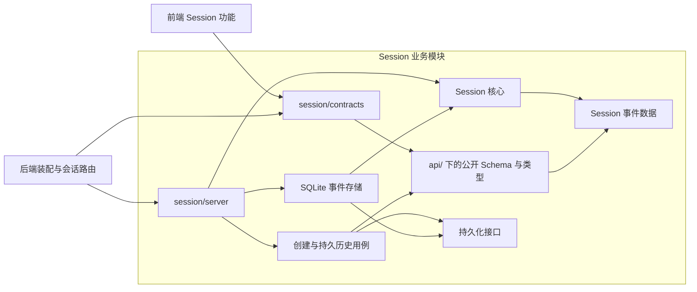

# Design

## Context

动机与范围见 proposal.md。任务 1.1–1.4 已建立前后端、共享协议与同步 SQLite SessionStore；模型循环尚未实现。Session 参考基线为 DSH 已提交版本 `d347e703908d0406b7a7ef80e3a0e594d86b2215` 的 `packages/core/session`、`packages/session/session-persistence`、`session-persistence-jsonl` 和 `session-checkpoint-policy`。参考仓库 Session index/types 的未提交修改不自动纳入基线。对齐对象是 Session 的数据、接口和行为，持久化介质改为 SQLite，装配改为普通 TypeScript 与 emit；不是复刻 DSH 全部插件和业务功能。

## Goals / Non-Goals

**Goals:** 对齐 DSH 的追加日志、历史派生、请求重建、fork、存储 handle、写入所有权和崩溃修复，提供显式 `session.flush()` 检查点；保持连接、Turn、工具操作和会话事实独立，验证审批前不执行、模拟工具幂等及超时结算。

**Non-Goals** 第一期采用固定装配与 SQLite 新格式。工具结果核实、迟到结果结算、工具自动重试、跨进程续跑、权限体系与旧历史格式迁移留待后续。压缩不做分块摘要、长文本拆分、分层合并、摘要章节校验或格式修复，不增加压缩总时长限制；模型请求原有的超时与取消仍适用。紧凑流保留已结算的统一流分片及时间，硬崩溃时仍在生成的草稿随进程退出。

## Decisions

### 1. 固定装配与职责分离

第一版使用 Node.js 24 和 pnpm 10 workspace，所有工作区包采用 TypeScript 严格类型检查。

| 工作区 | 技术与职责 |
| --- | --- |
| `apps/web` | React 与 Vite，负责页面、前端 Session 和 `follow` 帧消费。 |
| `apps/server` | Fastify 5 应用启动与固定装配，组合业务模块，并维护 Agent 执行、模型适配和工具治理。 |
| `packages/session` | Session 业务模块，维护会话核心、持久化能力和 Session API；通过独立入口向浏览器暴露公开契约，向后端暴露服务端能力。 |
| `apps/mock-mcp` | 工具接入阶段加入的本地模拟 MCP 服务，独立启动，用于验证工具调用、超时及幂等。 |

后端启动入口固定装配 SessionStore、SessionPersistence、AgentManager、LlmRuntime、Provider Adapter、压缩能力、工具批次调度器、工具执行服务、ApprovalService 与 MCP Client。SessionStore 管理内存 Session，Session 持有不可变日志和派生缓存；AgentManager 管理每会话 ReActAgent 及写 handle 的释放权。ReActAgent 驱动 Turn/Step，协调输入、活跃草稿和订阅顺序。工具执行服务负责参数与结果校验、策略和正文，审批服务负责等待及返回审批决定，批次调度器负责派发顺序和配对结果写日志。HTTP/SSE 负责请求与连接，网络等待在会话提交串行区外执行。

压缩由 `apps/server` 的应用能力拥有，组合 token-meter、工具结果修剪、安全前缀选择和摘要调用；模型容量由 LLM 服务提供。Session 核心只维护事件、surface 和暂存提交语义，不依赖 Provider 路由或应用 hook。浏览器继续从 Session API 消费纯契约，不引入服务端计量和模型调用实现，不为这些同一能力内的实现预建公共包。

事件连接只提供类型化 `on/emit`：监听器同步接收通知，不通过返回值控制流程，不等待异步监听器。注册返回取消订阅函数；emit 按本次派发开始时的监听器快照顺序调用，单个监听器异常独立报告，不阻断其余监听器或撤销已接受事件。持久化监听器同步复制事件并入缓冲，异步数据库错误在 flush 时报告。Session.append 的日志接受与发布过程禁止重入。初始化先绑定持久化再开放生产；关闭先停止生产、排空缓冲、解除监听，再释放 handle 所有权和数据库资源。

本地在仓库根目录运行 `pnpm dev` 启动 Web 和后端。Vite 将 `/api` 下的 HTTP 和 SSE 请求转发到本地 Fastify。模拟 Provider 在后端进程内作为 Model Adapter 装配，模拟 MCP 服务按工具验收需要另行启动。

```text
React --> HTTP / SSE --> AgentManager --> ReActAgent
                              |              |
                              v              +--> LlmRuntime --> Adapter --> Provider
                       Session / Event Log   |
                              |              +--> Compaction --> LlmRuntime
                              |              |    meter / prune / summary
                              |              +--> Tool Scheduler --> Tool Service --> Tools
                         emit |                     |
                              v                     | await session.flush()
                    SessionPersistence <------------+
                              |
                         SQLite Handle
```

监听派发分离 Session 与数据库实现，关键动作直接 await 显式方法，不以 emit 成功代替持久化、审批或执行许可。第一版串行执行工具；模型一次返回多个调用时逐个处理，前一调用导致本轮终止则后续调用不调度。

#### 1.1 会话级 Agent 生命周期与消息接受

同一已加载 Session 对应一个 ReActAgent，跨多个 Turn 存活。AgentManager 按 sessionId 管理实例并合并并发加载，取得写 handle、读取日志并完成必要修复后才发布实例。创建空会话仅保存并 flush header，不创建 Agent；首次提交消息或显式执行手动压缩命令按需加载。历史查询和 SSE 只观察，不创建 Agent、不启动模型请求。Agent 的 `idle`、`running` 和压缩阶段引入的 `maintenance` 是进程运行状态。Turn 的成功、失败、取消、中断分别由持久记录表达。

Turn 完成回到 idle，浏览器断线不销毁 Agent。AgentManager 显式关闭时先拒绝新输入、取消当前活动并等待驱动退出，再排空并关闭 handle、解绑和移除实例。空闲 Agent 继续持有写入权，不在每个 Turn 结束时释放；初期省略自动空闲回收、inbox、steering 和自动后台维护调度。

应用层在 `commands.ts` 提供 `SessionCommandController`，集中承载会话命令并在每个方法显式选择 Agent 激活策略。Session 路由通过装配时注入的命令入口调用 `prompt`。读取和订阅不激活 Agent，创建空会话只写元数据。诸如 fork、rename、selectModel 的命令各自声明激活条件，具体入口依其所属阶段交付。

`prompt(request: SessionPromptRequest): Promise<SessionPromptValue>` 接收 `sessionId`、客户端生成的 `requestId` 和 `content`。首版 `content` 使用文本块，内部用户消息保存校验后的内容。首版不声明 `mode` 或 `clientTimeZone`。现有消息 HTTP 路径 `POST /api/sessions/:sessionId/messages` 从路径取得 `sessionId`，请求体提供 `requestId` 和 `content`，由路由校验后交给命令。首次受理和重发命中统一返回 `202 { accepted: true }`，Turn 标识与执行状态从 Session 原始事件取得。

例如，请求体 `{ "requestId": "req-1", "content": [{ "type": "text", "text": "你好" }] }` 首次受理后返回 `202 { accepted: true }`。原响应丢失时，即使原 Turn 仍在运行，重发 `req-1` 也返回相同结果。此时发送新编号 `req-2` 则返回 `409 { code: "agent_busy" }`。

会话命令完成必要的恢复校验并取得写入权后，在同一 Session 串行区内先查 `requestId`，再执行新请求的状态检查和受理。命中直接确认首次受理，即使当前内容不同或 Agent 非空闲也沿用首次内容。客户端改动内容后使用新编号。未命中时仅 `idle` 可受理，其他 Agent 状态返回 `409 { code: "agent_busy" }`。被拒绝的新编号不占用，也不排队。

首次受理时依次调用 `Session.append()` 追加 `turn/start` 和真实用户的 `user/message`。每次追加独立接受并发布 `session/event`。用户消息已追加且执行循环接管后才确认受理，不等待 pre-step、Provider 或磁盘写入。执行循环固定本 Step 的路由、系统提示词、工具和生效生成参数，等待 pre-step 后才追加 `step/start`，再从最新 surface 派生请求并显式 flush。取消或失败发生在 Step 打开前时，只结算实际打开的 Turn，不补造 Step。首次请求检查点失败时阻止模型调用，后续执行失败沿 Turn 的故障路径处理。编号从本会话已接受的用户消息派生，重启后从已提交前缀重建，继承消息不登记为子会话自身受理。若原事件在进程退出时尚未落盘，重开后原编号按未命中处理。

pre-step 是可等待、传递当前取消信号的运行 hook，不是持久事件，也不复用同步 `Session.emit` 的返回值控制流程。首个和后续 Step 均遵守该顺序；本次只在固定装配中提供所需等待点，不引入通用插件框架。压缩期间或同 Step 超限重试期间配置变化不改变本步快照，下一 Step 才读取新配置。

取消入口为 `POST /api/sessions/:sessionId/cancel`。命令按 `sessionId` 查找已挂载的 Agent 并调用 `agent.cancel(cause, options)`，返回 `202 { accept: true }`。`running` 时取消处理请求那一刻的当前 Turn，`maintenance` 时触发 `runMaintenance()` 持有的信号，`idle` 时直接确认受理。未挂载时返回 `404 { code: "session/not-found" }`。该入口只查找现有实例。任务结算由历史与 SSE 确认。

#### 1.2 标识来源

`sessionId` 由后端生成。`turn` 在 Session 内从 1 递增，`step` 在每个 Turn 内从 1 递增。重启从已提交日志继续分配，fork 保留继承前缀中的编号，再从子日志已有的最大轮次继续。崩溃时尚未落盘的编号可重新分配。新消息的 `message.id` 使用 UUID，继承和工具结果替换保留原值。同一消息 ID 可出现在父子会话中，数据库不得给 `message.id` 添加跨会话唯一约束。事件以 `(sessionId, seq)` 定位。`requestId` 由客户端生成，仅用于同会话自有用户消息的查重。`attemptId` 由 `AssistantStreamAttempt` 用于关联 Agent 生命周期内的实时流。`callId` 保留模型返回值，按 `(turn, step, callId)` 在所属 Session 内关联。参数校验后由后端生成 `operationId`，绑定工具、定义版本与不可变参数。Provider 要求请求内调用 ID 唯一时，由 Adapter 成对转换发出的调用 ID 和结果引用。

#### 1.3 业务模块拥有契约与预期组织

契约由决定其语义的业务模块维护，原 `packages/protocol` 已移除。旧包所剩审批定义没有消费者，后续按 3.3 在审批能力中实现。以下图与目录记录本阶段实际边界。Context 和任务 1.1–1.4 中的共享协议描述保留为历史记录。



箭头表示模块依赖，不表示 HTTP 数据流或运行时调用顺序。前端通过 HTTP/SSE 调用服务端业务接口；浏览器仅依赖契约入口。此图聚焦 Session 的定义归属与入口边界，Agent、模型、工具和审批的执行职责仍见 §1 的运行链路及后续章节。

```text
apps/
  server/src/
    index.ts                     启动与关闭
    app.ts                       固定装配、注册业务路由
packages/
  session/src/
    api/
      submission.ts              会话创建与旧版提交契约
      prompt.ts                  新版 prompt 请求与受理契约
      history.ts                 旧版历史契约
      raw-history.ts             原始事件与新版持久历史封装
      follow.ts                  当前 SSE 帧契约
      contracts.ts               选择性导出浏览器可用契约
      use-cases.ts               持久化创建与历史查询
    session.ts                   Session 行为及相关参数、结果
    events.ts                    内部持久事件及边界校验
    persistence.ts               持久化接口及相关参数、结果
    writer.ts                    固定窗口写入缓冲与持久性检查点
    recovery.ts                  遗留 Turn 修复与只读推导
    storage/sqlite-persistence.ts SQLite 事件存储及事务核对
    storage/ownership.ts         进程间实例与会话写入锁
    server.ts                    服务端公共入口
```

目录展示关键职责，不是完整文件清单或必须逐项创建的模板。单文件内部状态留在实现文件；功能参数与结果默认与功能共置。形成独立主题或出现独立消费者后再拆分，不按类型数量或文件长度机械建目录。

| 定义 | 所有者与位置 | 消费方式 |
| --- | --- | --- |
| 消息提交请求、响应 | Session API 的 `api/prompt.ts` | 运行时边界用 Zod 4 定义并用 `z.infer` 推导类型；正式路由和浏览器共用。 |
| 历史记录封装 | Session API 的 `api/raw-history.ts` | 历史查询使用 `{ type: "event", event }`，供后续 follow 共用。事件正文沿用 Session 事件的数据契约。 |
| SSE 业务帧 | Session API 的 `api/follow.ts` | 服务端发布与浏览器消费共用。 |
| Session 事件 | `events.ts` | 日志、持久化、模型派生和历史契约共用纯数据定义。 |
| Session 操作选项与结果 | 默认共置于 `session.ts` 或使用它的功能文件 | 已校验的进程内结构直接用 TypeScript 类型。 |
| SessionPersistence、SessionHandle 及相关约定 | `persistence.ts` | 由会话能力定义，调用方与 SQLite 实现共同遵守。 |
| SQLite 行结构与事务辅助类型 | `storage/sqlite-persistence.ts` | 留在 SQLite 实现内。 |
| Agent 活动状态与取消资源 | 使用它的 Agent 实现文件 | 不作为浏览器可传输对象。 |
| 发送占位、订阅代次与草稿状态 | 前端对应功能文件 | 不进入后端持久契约。 |

前端从 `@mharness/session/contracts` 导入公开 Schema 与类型，后端装配从 `@mharness/session/server` 导入服务端能力，模块内部直接相对导入具体功能文件。`api/contracts.ts` 只选择性导出，定义保留在所属功能文件。内部存在类型文件不自动产生 `/types` 公共入口；纯类型依赖使用 `import type`、`export type`。`types.ts` 默认承载纯类型声明，运行时解析和校验留在具体功能模块。

浏览器契约入口的完整运行时与类型依赖链均不能引入 Fastify、SQLite、Node.js 资源或服务端实现；仅使用 `import type` 不足以保证隔离。包的 `exports`、依赖声明和编译配置应与这两个入口一致。Session 核心独立拥有事件契约，Session API 复用其可在浏览器加载的 Schema 和推导类型，并负责传输封装。追加和重放所用的关联校验若依赖会话运行状态，留在核心行为中。

后续审批等能力按相同所有权原则组织，形成独立职责和消费者时再确定是否建立独立包，不复制空目录层级。本设计不引入 DSH 的声明合并、插件装配或 RPC 机制。

模块职责、依赖方向或公共入口变化时，同步更新本节架构图；关键文件归属变化时更新目录示意。仅新增实现细节文件不要求修改模块图。实施迁移时检查消费者类型解析、相关行为及前端构建，并核对浏览器入口未带入服务端依赖。

### 2. Session 事件日志与派生状态

会话层级采用 Session → Turn → Step。Step 包含同一次模型决策的一次或多次模型尝试及成功后产生的工具批次。当前 Step 完成工具批次后，模型续答属于下一 Step。输入上下文超限后的压缩重试仍属于同一 Step，每次开启实时流时分配新的 `attemptId`。

Session 的事实来源是只追加日志，会话元数据 header 独立保存。事件外壳为 `{ type, seq, time, data }`，由 `type` 决定 `data`。`seq` 从 0 连续递增，`session.seq` 是事件数及下一条的位置。`time` 与 `createdAt` 使用非负安全整数 Unix 毫秒。内存范围快照的 `cursor` 是完整前缀的最后位置，空前缀为 `-1`。追加前验证无损 JSON、关联和 surface 操作，并取得独立深快照，接受后递归冻结。接受失败时序号、日志和通知均保持原样。

进程内写入方通过类型化的 `Session.append()` 提交事件。`type` 在编译期约束 `data`，输入和返回类型均由 Session 核心维护的共享事件 Schema 推导。返回的不可变事件保留输入的事件类别。例如，追加 `tool/call` 的调用方可以直接读取返回事件的 `data.callId`。输入涵盖多个事件类别时，返回相应类别的联合。`seq` 由 Session 分配。追加继续校验实际载荷，依赖当前日志的关联规则由 Session 判断。持久化重放接收未经信任的原始记录，按同一事件 Schema 校验，并核对记录原有序号与重放位置。

只有 `user/message`、`assistant/message` 和 `tool/result` 参与 surface。它们在事件外层声明 `surfaceOp: "append"` 或 `surfaceOp: { op: "replace", start, end }`，替换用外层 `sourceEventSeqs` 引用被覆盖节点。`user/message.data` 直接保存消息的 `id`、`role`、`source` 和 `content`。真实用户消息另带 `turn` 和 `requestId`。压缩摘要使用 `source: { kind: "compact", compactionId }` 并分配新消息 ID；手动命令产生的 checkpoint 另关联 `sourceCommandId`，自动压缩及既有记录无需该字段。Assistant 和工具结果的消息本体放在 `data.message`。工具结果替换在日志追加完整结果，保留原消息身份与关联，仅改动模型可见 `content`。`deriveMessages()` 复用不可变节点并返回独立数组。普通追加增量扩展缓存，替换使缓存失效并递增 `replaceGeneration`。聊天视图继续显示原始交互。

`SessionCommandController.fork({ sessionId, atSeq? })` 从同一份父会话快照选取稳定前缀。已加载父会话用内存快照，未加载时用 `handle.read()`。锚点在 Turn 内时选该 Turn 的 `turn/end`，在两轮之间时归到上一轮。省略锚点或超过已观察到的末尾时，选最近已经结束的 Turn。候选尾部最多延伸至下一轮 `turn/start` 前。检查整个候选前缀中的 Turn、Step 和独立压缩是否闭合。若回退到未配对的开始记录前会截断它所在的 Turn，则再退到该 Turn 开始前并重新检查。保留满足条件的最长前缀。`command/done` 缺失本身不触发回退。压缩已有 `compaction/end` 时保留压缩终态及已提交的摘要和 checkpoint。只有 `command/run` 时也原样继承，前端显示为历史。没有稳定的闭合 Turn，或锚点在尚未结束的 Turn 内时，返回 `session/fork-unavailable`。fork 只依赖这份父快照，父会话无需写入或 flush。

`cut` 是排他的父日志结束位置。子 Session 加载 `source.events.slice(0, cut)`，并保存 `inheritedEventCount: cut` 和 header 中的 `parentSession`、`isSeeded: true`。子会话自己的 `session/end-seed { inherited: true }` 在 `seq=cut`，是第一条自有事件。多层 fork 可能复制祖先的标记，各会话按自己的 `inheritedEventCount` 划界。继承事件保留 `seq`、原标识和关联，包括继承用户消息的 `requestId`。

`commands.create()` 负责空会话，`commands.fork()` 计算 seed 并交给 Agent 初始化。初始化通过 `persistence.create(childHeader, { inheritedEventCount: cut, signal })` 取得准备中的写 handle，首次 `append()` 原子提交子 header、继承数量、seed、标记和初始化新增事件。成功后绑定普通写入器，发布子 Session 和 Agent，再发出 `session/created`。初始化事件由初始快照交付。子会话重启直接读取自己的持久日志，即使父会话实际落盘的前缀更短。

运行协调器持有活动任务、AbortController 和订阅者，在持有写入所有权的前提下串行接受输入，同一会话最多有一个活动 Turn。数据库若保留 Turn/审批等查询索引，必须与事件在同一事务更新且可从日志重建，不允许绕过日志单独改变业务状态。

`turn/start.data` 为 `{ turn }`，`step/start.data` 与 `step/end.data` 为 `{ turn, step }`，`turn/end.data` 为 `{ turn, reason }`。`reason` 按 `kind` 区分 `completed`、`aborted`（附 `reason: TurnEndCancelCause`）、`blocked`、`error`（附 `error: LlmFailure`）、`max-tokens` 和 `interrupted`。正常回答与工具批次主动结束都用 `completed`。`interrupted` 由崩溃修复写入。`running` 和 `awaiting_approval` 等展示状态由活动范围与审批记录派生，浏览器派生规则见 §8。

公开状态由会话日志投影，不另设可独立修改的消息或状态事实。

#### 2.1 存储服务与每会话 handle

持久化接口归 Session 模块。每个 handle 绑定一个会话并持有只读元数据 `id`、`header`、`access`、`inheritedEventCount`。`SessionHeader` 包含 `sessionId`、`createdAt`，分支还包含 `parentSession` 和 `isSeeded: true`。以下是约定的签名，其中 `SessionAccess` 为 `"read" | "write"`。

```ts
interface SessionPersistenceCreateOptions {
  readonly inheritedEventCount?: number
  readonly signal?: AbortSignal
}

interface SessionPersistenceSnapshot {
  readonly header: SessionHeader
  readonly inheritedEventCount: number
  readonly eventCount: number
}

abstract class SessionPersistence {
  abstract create(header: SessionHeader, options?: SessionPersistenceCreateOptions): Promise<SessionHandle>
  abstract open(sessionId: SessionId, access: SessionAccess): Promise<SessionHandle | undefined>
  abstract stat(sessionId: SessionId): Promise<SessionPersistenceSnapshot | undefined>
  abstract list(): Promise<readonly SessionPersistenceSnapshot[]>
  abstract flush(): Promise<void>
}

interface SessionHandle {
  readonly id: SessionId
  readonly header: SessionHeader
  readonly access: SessionAccess
  readonly inheritedEventCount: number
  read(offset?: number, length?: number): Promise<readonly SessionEvent[]>
  append(events: readonly SessionEvent[]): Promise<void>
  flush(): Promise<void>
  close(): Promise<void>
}
```

`create()` 取得写入权并准备元数据，根会话的继承数默认是 0。创建参数的 `signal` 用于取消取得写 handle 的过程。`open()` 显式指定访问模式，普通打开和 `stat()` 查询不到已提交会话时返回 `undefined`。已有写入者时仍可用只读 handle，写入打开报可区分的所有权冲突。只读 handle 调用写操作时拒绝。`stat()`、`list()` 以已提交元数据和事件总数回答查询，无需扫描事件正文。`eventCount` 包含继承事件、seed 标记及新增事件。

`handle.read()` 默认返回完整的已提交事件数组，供 HTTP 持久历史、恢复及未加载会话的 fork 使用。`offset` 默认 0，省略 `length` 时读到该次截点的末尾。参数须为非负安全整数，`offset` 不能超过此次读取的已提交事件数。提供 `length` 时，完整区间 `[offset, offset + length)` 须落在该前缀内。已提交 `0..7` 时，`read()` 返回 8 条，`read(8, 0)` 返回空数组，`read(0, 10)` 报范围未覆盖。读取无需排空缓冲。实时 follow 和已加载会话的 fork 直接取内存快照，例如内存另外接受 `8..9` 时可读到 10 条。HTTP 查询和 follow 的 cursor 直接取所读取前缀末条事件的序号。

SQLite 使用 `node:sqlite`，SQL 集中在后端。header 与事件分开保存，事件以 `(sessionId, seq)` 唯一，事务校验并追加连续批次与必要查询索引，成功后才推进持久游标。schema 使用单调版本号；未知版本、事件词汇或无效记录拒绝读取，不跳过损坏记录。JSONL 压缩、尾行截断与文件世代迁移不移植到数据库。

创建写 handle 时先校验 ID、取得写入权并暂存 header 和继承数量，普通 `stat/list/open` 只观察已提交的会话。首次 `await handle.append(events)` 在同一 SQLite 事务写入 header、继承数量和整个初始批次，提交成功后才返回。后续 append 各自在事务中校验并提交连续批次。直接调用写 handle 的 append 已提供持久化确认；普通运行的 `session.flush()` 仍负责排空尚在写入器缓冲中的事件。

普通创建用写 handle 的显式 `flush()` 提交空 header，成功后 HTTP 返回 201。已发布会话关闭时先处理待写事件，再释放资源和所有权，失败时同样释放并报告错误。读写 handle 均由持有者 `close()`，关闭幂等且不可取消，关闭后其他操作拒绝。放弃准备中的会话时，关闭只释放资源和写入权。后端统一 flush 只处理已接入活跃写入器的会话。

#### 2.2 缓冲、串行写入与显式检查点

`Session.append()` 同步更新内存日志，已发布的 Session 发出 `session/event`。每个写入器只订阅所属 Session，并在自己的队列中缓冲这些事件。初始化期间经写 handle 提交的事件已由初始快照交付，后续写入队列从新事件开始。

首个待写事件启动固定窗口，初始值为 200ms，后续到达的事件加入缓冲且不重置截止时间。到期时把当前待写事件交给该 handle 的串行写入链，写入期间到达的事件进入下一批。窗口仅决定何时开始排空，各批始终按事件序号写入。

显式 `session.flush()` 取消等待窗口，等待在途写入，调用 `drainLive()` 排空路由缓冲，再执行写入器的持久性屏障 `writer.flush()`。后端统一 `flush()` 捕获调用时的活跃 writer 列表，逐个执行相同步骤。某个 writer 失败时继续处理余下会话，最后抛出 `AggregateError`，每项保留 `sessionId` 和原错误。确认回滚的失败批次回到队首，暂停自动定时重试，显式 flush 或关闭时可重试。屏障失败时，已确认提交的批次保持原提交状态。

对外入口为 `await session.flush()`，内部委托绑定 handle 排空事件并确认提交，持久游标须覆盖调用开始时的最后事件位置 `session.seq - 1`；未绑定、入队失败或未覆盖该位置均报错。创建成功响应前、模型请求前、顶层工具正文前及关闭时均设检查点。工具调度记录、操作信息和有效审批先 flush，再检查取消并进入正文。对应检查点失败时不启动模型生成或工具正文，若检查点失败导致当前 Turn 停止，向前端报告执行失败。Adapter 不负责调用 Session 检查点。

检查点失败时协调器暂停该会话的新任务和外部效果，保持日志与缓冲顺序。持久化后端负责确认事务结局，提交成功后才确认相应位置。确认整批回滚且写入权仍有效时允许重试原批次。结果有待核对时，先确认原事务已结束，再读取已提交事件，初次创建同时核对 header 和继承数。完整批次一致时按成功处理，确认整批未提交时可重试。读取失败、部分匹配或内容冲突时向调用方报告并保持写入阻塞，下一次显式 flush 先重新核对。现有已确认历史和实时内存状态仍可观察。

prompt 受理的 `turn/start` 和用户消息依次进入普通缓冲，可进入不同批次；`step/start` 在 pre-step 后由驱动另行追加。模型调用前的检查点覆盖当次消息快照、生效配置 header 及所需的压缩提交核对。压缩等先提交再发布的操作使用独立的暂存批次。

#### 2.3 所有权与崩溃修复

第一版每个 SQLite 库只运行一个在线后端。在线后端在启动修复及开放 HTTP/SSE 前取得按规范化数据库路径确定的进程间实例锁，并持有到停止接收请求、排空并关闭存储之后。重复实例即使使用不同端口也在取得锁失败时停止启动，不能修改原实例的记录。业务写入、启动修复及实时 follow 由持锁后端负责，其他进程可用只读 handle 读取连续的已提交前缀。

每会话写入所有权仍覆盖 write handle 生命周期。后端在进程内阻止重复写 handle，并以规范化数据库位置和 Session 标识确定跨进程会话锁。实例锁和会话锁均由操作系统持有，进程退出自动释放，不按超时抢占活跃所有者。read handle 不争夺所有权，独立会话不共用生命周期写锁，SQLite 写事务只用于原子提交。

确定持久化接口前，先用 Windows 上的两个独立进程和临时 SQLite 库验证实例锁与会话锁。至少验证相对与绝对路径指向同一锁、同一会话写入互斥、不同会话锁可并存、强制退出后另一进程能取得锁，以及持锁期间只读查询仍可用。记录可支持的路径别名、库尚未创建时的锁身份和锁原语，作为实现与验收依据。

#### 1.16 Windows 双进程锁验证

候选方案使用 `node:sqlite`，在规范化业务库路径旁的 `<数据库文件名>.locks/` 目录内，为实例和每个会话分别打开 `instance.sqlite` 与 `session-<SHA-256(sessionId)>.sqlite`。每个锁连接用 `BEGIN IMMEDIATE` 和零忙等待取得对应文件的写锁。连接在持有期内保持打开，无需向锁文件写数据。锁文件保留，避免不同进程因重建文件而锁定不同文件对象。业务库仍使用独立连接和短事务。写事务互斥见 [SQLite 事务文档](https://www.sqlite.org/lang_transaction.html)。

业务库尚未创建时，用父目录的 `realpath` 与目标文件名定位锁目录。库已存在时，用文件的 `realpath`。Windows 普通大小写不敏感目录由文件系统将大小写别名解析到同一个锁目录。已验证相对路径、绝对路径、文件名大小写别名及父目录 junction。硬链接、悬空文件链接和网络路径不属于本次验证范围。1.11 实现时，只有确认目标文件尚不存在才走父目录分支，其他路径解析错误须报告。

在 Windows 11（构建 22631）、Node.js 24.13.0 和 SQLite 3.50.4 上，进程 A 用相对路径取得实例锁与会话 A 的锁。业务库创建前后，进程 B 用绝对路径、大小写别名和 junction 路径申请实例锁均得到 `SQLITE_BUSY`。进程 B 申请会话 A 的锁失败，申请会话 B 和另一业务库的实例锁成功。进程 A 持锁期间，进程 B 用只读连接取得业务库中已提交的 `seq=0` 记录。强制结束进程 A 后，锁文件仍在，进程 B 能重新取得实例锁和会话 A 的锁。

持有实例锁后，启动阶段检查遗留活动会话，逐个取得临时 write handle，提交修复批次后关闭，不创建 ReActAgent 或恢复执行，使用户无需先发消息即可查询中断历史。首次加载也按同一恢复规则检查。所有权冲突的会话不修改，真实存储或修复错误不能伪装成已恢复。数据库负责物理事务完整性，Session 恢复负责语义完整性。

恢复通过 `handle.read()` 取得已提交日志，由 `interruptedTurnClosers()` 按 `(turn, step, callId)` 从 Assistant 调用声明匹配调度及结果。缺结果时按原声明顺序补 `isError: true` 的 `tool/result`。已有 `tool/call` 时用 `TOOL_OUTCOME_UNKNOWN` 并引用该调度事件，尚无调度事件时用 `TOOL_NOT_STARTED` 并引用 Assistant 声明。已有 `tool/operation` 时沿用其 `operationId`。调度与结果需引用更早的有效声明，重放时校验调度保存的工具名和原始参数。冲突或孤立引用导致加载失败，修复批次保持未提交。工具结果的 surface 替换沿用同一次调用的结算身份。

恢复把缺失工具结果、实际打开的 `step/end` 和 `turn/end { turn, reason: { kind: "interrupted" } }` 合在一次写 handle 的 `append()`。前缀止于 `turn/start` 时只关闭 Turn。缺失的 `user/message` 保持缺失，对应 `requestId` 仍可受理。待决 `approval/asked` 保留，由对应结果或 Turn 终态关闭待审批状态。重复恢复只读到已结算前缀，模型与工具调用次数保持不变。

只读查询可从已提交前缀临时推导中断和缺失结果。临时结果只属于查询视图。`handle.read()`、HTTP 持久历史及历史游标反映真实已提交的事件。同进程 live Session 按实时事实展示活动 Turn。

#### 2.4 会话压缩

压缩只改变后续模型可见的 surface。工具修剪、历史摘要和原始执行事实分开记录，原聊天历史不删除；摘要使用修剪后的当前前缀，不从原日志重新取出已隐藏内容。

##### 2.4.1 路由、计量与预算

本 Step 在 pre-step 前解析并固定实际 `provider/model`、system、tools 和生效生成参数。LLM 服务从本地注册或配置的模型信息返回该路由的 `contextWindow` 与默认输出预算；首次请求不依赖历史 header，切换模型也不使用上次请求的旧容量。业务输出预留优先取本步生效的 `maxTokens`，缺省取模型默认输出预算。缺少预算所需信息时，自动压力检查告警并跳过，业务请求仍须通过正常准备、检查点和取消检查；不猜测窗口或以零代替未知输出预算。

token-meter 对该路由实际会发送的消息投影计量；reasoning 是否计入取决于请求适配。基础估算采用 JavaScript 字符串 `.length`，即 UTF-16 code unit 数，不是 Unicode 码点：

```text
CHARS_PER_TOKEN = 4; BLOCK_OVERHEAD = 4; ROLE_OVERHEAD = 4
文本或 reasoning 块 = ceil(text.length / 4) + 4
工具调用块 = ceil(toolName.length / 4) + ceil(arguments.length / 4) + 4
工具结果块 = 内部各内容块估算之和 + 4
其他内容块 = ceil(JSON.stringify(block).length / 4) + 4
消息 = 各内容块估算之和 + 4
system = 存在时 ceil(system.length / 4) + 4，否则 0
tools = 非空时 ceil(JSON.stringify(tools).length / 4) + 4，否则 0
输入估算 = system + tools + 当前模型可见消息估算
压力 = 输入估算 + 业务输出预留
thresholdTokens = floor(contextWindow × 0.8)
retainTokens = floor(contextWindow × 0.16)
```

多块分别计费，工具结果递归累计，未知块按 JSON 长度估算。它是确定性启发式，不声称与 Provider 精确计数一致；Provider 的规范化输入超限仍是独立恢复信号。16% 是完整模型窗口的尾部节点预算，不是已用量的比例，也不是压缩后总压力上限。

##### 2.4.2 三种入口与机会

| 入口 | 首次触发条件 | 先修剪工具结果 | 保留预算 | 摘要调用上限 |
| --- | --- | --- | --- | --- |
| pre-step `pressure` | 压力达到或超过阈值 | 是 | 窗口的 16% | 2 次 |
| `context-overflow` | Provider 明确报告输入超限，不检查 80% | 是 | 0 | 1 次 |
| 手动 `/compact` | 用户命令，不检查 80% | 否 | 0 | 1 次 |

pressure 先修剪并重新计量，低于阈值就结束。仍达到阈值时选择安全前缀并摘要。`compactionRetries: 1` 只允许首次摘要成功替换后、压力仍达到阈值时再摘要一次，不用于调用失败重试。第二次使用更新后的 surface，并为该次摘要建立独立 `compactionId`；两次机会耗尽仍未达目标时保留已提交结果、告警并继续 pre-step。80% 是收敛目标，不是每次有效摘要落盘的条件。

pre-step 压缩边界捕获摘要、校验或提交阶段异常，记录服务端警告后继续后续流程。继续流程不等于已获模型调用许可：取消仍生效，业务模型前必须检查存储准入并执行 `flush()`；提交有待核对或检查点失败时不能调用下游 Adapter。后续 Step 独立重新检查压力。此处不增加压缩总时长限制，也不保留此前讨论的 8 次调用预算；每次模型调用仍受请求级超时和取消约束。

context-overflow 先保存失败的业务 Attempt，再修剪并重测，但无论重测是否低于 80%，均以零保留预算选择最大安全头部，有范围就尝试一次摘要。摘要失败但修剪已经落地时不回滚修剪。以恢复前后的 `replaceGeneration` 判断是否确有替换，且未取消、检查点通过后，才授权同 Step 内一次业务请求重试；没有替换则保留原业务请求错误。`maxOverflowRetries: 1` 限制连续超限的业务重试次数，不限制整个 Turn；成功的助手响应（含正常工具调用响应）或回到 idle 后重置。

##### 2.4.3 工具结果修剪

正常 pressure 仅在总压力达到阈值后调用修剪器，context-overflow 则直接尝试。对当前 surface 所有工具结果检查文本块合计长度，包括最近结果；文本超过 8192 个 Unicode 码点时，保留前 4096 和后 1024 个码点，中间使用 `[... tool result middle pruned ...]`。按文本块顺序应用合计预算，图片及其他非文本内容保留且不改变原有相对顺序。修剪计数与 token-meter 的 UTF-16 长度计数明确分开。

修剪只改变工具结果块的模型可见 content，保留消息 ID、调用关联、turn/step、operationId、isError、error 和 meta；不重新执行工具或 render。暂存批次按 `compaction/prune`、对应的替换 `tool/result` 顺序整体提交，记录被遮蔽节点及其修剪前估算 token 数，替换来源引用原结果。确认后才发布一次并推进替换代数。该批次独立于后续摘要，摘要失败也保留已提交修剪；仅有修剪时不补造摘要事件或摘要模型调用。

##### 2.4.4 安全前缀

对完整消息节点从最新向前累计其模型可见估算，先纳入末尾节点，再检查是否达到 `retainTokens`。超过预算的整节点保留，不截断。随后检查工具调用与全部配对结果，必要时继续向更旧方向移动边界。预算为 0 时仍保留至少一个末尾节点和必要配对。边界到历史开头则返回无可压缩范围，不请求摘要模型。

摘要候选只能是剩余的连续旧前缀；允许包含当前 Turn 已完成的旧 Step，但不能包含未结算交互或拆开工具配对。例如窗口 100000、尾部预算 16000，节点为 `[A:8000,B:6000,C:7000,D:5000,E:6000]` 时保留 C、D、E（18000），摘要 A、B。pressure 使用 16%，手动和 context-overflow 使用 0；三者共用选区校验。

##### 2.4.5 摘要请求、提示词与包装

一次摘要直接处理整个安全前缀，不读取保留尾部，也不拆分超长消息或分块合并。摘要调用使用本步固定路由（独立维护则在命令开始固定路由）、专用指令和 `maxTokens: 8192`，不提供业务工具；目标模型允许时关闭推理，不允许时使用合法配置。推理 token 可能消耗该预算。输入超限等调用失败直接退出，不自动拆分重试。

固定摘要指令如下；`<compacted-summary>` 同时是包装标记：

```text
You are now acting as a compaction engine for this AI coding assistant. Condense the conversation ABOVE into a structured checkpoint that lets another model resume the work with no loss of essential context.

Output EXACTLY the Markdown structure below: keep every section, in order. Use terse bullets, not prose paragraphs. Write "(none)" for an empty section — never drop a section.

## Primary Request and Intent
- [the user's original and evolving goals; quote verbatim where the exact wording matters]

## Key Technical Concepts
- [technologies, frameworks, patterns, and conventions in play]

## Files and Code
- [exact path: why it matters, key changes or snippets]

## Errors and Fixes
- [error: how it was resolved, plus any related user feedback]

## Pending Jobs
- [explicitly requested work not yet completed]

## Current Work
- [precisely what was in progress at this checkpoint]

## Next Step
- [the single next action, directly in line with the most recent request, or "(none)"]

## Critical Context
- [decisions and their rationale, constraints, user preferences, open questions, data needed to continue]

Rules:
- Write concise English engineering prose. Preserve exact file paths, commands, error strings, identifiers, numeric values, function signatures, and syntax fragments.
- Capture user feedback and explicit instructions faithfully, especially corrections.
- Do NOT mention this summarization request or that the context was compacted.
- Output only the checkpoint text: do not call any tool or take any other action.
- If the conversation already contains a <compacted-summary> block, it is a PRIOR checkpoint. Do not copy it forward verbatim: preserve still-true facts, drop stale ones, and merge newer information into a single consolidated summary under the same structure.
```

这里的 Current Work、Next Step 和最新请求均以候选前缀的截点为准，不推断未提供的保留尾部。已有检查点与新旧前缀合并，后续保留消息中的新指令继续生效。

模型检查点 S 是新 ID、`role: user`、`source: { kind: compact, compactionId }` 的合成消息，不改写 system、tools 或保留尾部。内容按以下顺序包装为文本块，摘要正文可有多个文本块，Adapter 可按目标协议拼接：

```text
块 1：This is an automatically generated checkpoint condensing an earlier span of the conversation to free up context. Treat the captured context as established background and build on it without restating it. Continue the task directly from the messages that follow, without acknowledging this checkpoint.

<compacted-summary>
块 2：摘要正文
块 3：</compacted-summary>
```

只校验非空文本、未因输出上限截断、没有不支持的图片输出，以及带包装消息的估算严格小于被替换前缀。不校验八节是否齐全、顺序或 Markdown 格式，不做格式修复。未缩小等校验失败不提交替换，退出当前摘要循环；自动入口告警后继续，手动入口报告失败。

##### 2.4.6 暂存提交与恢复

在串行区确认该次 `compaction/start` 落盘，保存 `compactionId`、`turn`（独立维护为 null）并取得选区节点序列及不可变摘要输入，再在区外调用模型。HTTP 历史可读已提交日志，follow 可观察 live Session。提交时回到串行区重新定位，比较完整节点序列并复用 surface 替换与工具配对校验；选区外追加不单独构成冲突。

复用暂存提交，将 `compaction/summary`、带包装的 user 替换和成功 `compaction/end` 放在同一事务。确认后才更新内存、发布结果和推进替换代数；替换来源引用摘要及全部被覆盖节点。失败不提交该次摘要替换，保留先前已提交的修剪或摘要。已确认终态优先于迟到取消。结果待核对时维持存储阻塞，等原事务终止后读取可靠持久日志，每个 compactionId 至多一个终态，不将回滚的暂存批次放入普通排空。

普通已接受事件与压缩暂存批次的核对后动作必须分开。§2.2 的普通缓冲在确认回滚后仍可按原约定显式重试；压缩暂存尚未进入 live 日志，确认回滚后由原压缩流程处理失败，不允许普通 `flush()`、关闭排空或在线恢复隐式重新提交它。允许复用已开工的 8.5 提交接口，但不能只把暂存批次塞进现有 handle 的普通 pending/重提路径。这里约束结果和隔离语义，不要求更换已在实现的 API 名称或签名。

以下矩阵分别对摘要开始批次、成功摘要批次及工具修剪批次验收；普通 Session/handle/store flush、writer/handle/store 关闭和在线恢复均不能绕过相同的核对门：

| 核对结论 | 普通 flush | 关闭路径 | 在线恢复 |
| --- | --- | --- | --- |
| 原暂存批次已提交 | 采用原持久结果，仍加载的 Session 至多安装/发布一次，不重复 append | 不重提；已释放 Session 由重开重放，不为发布再激活 Agent | 先采用暂存结果再比较 live 与持久前缀，不能将“已提交但尚未安装”误判为普通历史损坏 |
| 原暂存批次确认回滚 | 不重提、不放回普通队列；普通已接受批次的既有重试语义保留 | 不因最后排空重新写入回滚批次，按原关闭契约释放资源并报告必要错误 | 不先靠通用 flush 重提；按压缩 ID 处理确实缺少的终态，再核验修复检查点与准入 |
| 原事务未终止或持久读取不可靠 | 核对失败，保持依赖写入与模型调用阻塞，不发布替换 | 不报成功排空或成功压缩，按关闭错误/资源释放契约处理 | 不采用暂时读不到作为未提交证据，不补终态、不开放 prompt/维护准入或调用 Adapter |

`recoverStorage()` 可能经过普通 flush；它必须先让暂存结论可靠、将已确认提交的批次安装到仍加载的 Session，再执行既有前缀一致性检查和遗留范围修复，最后才开放准入。该交接回归由 8.3 承担，8.5 先用可控调用验证本层三态契约。pre-step 捕获异常后继续只表示运行链继续，不能绕过此门；prompt 和手动维护共用相同存储准入。

启动恢复和在线恢复先取得可靠前缀。在线路径先核对并安装原暂存结论，再比较 live 与持久前缀。恢复先结算遗留压缩，再处理本会话自有的未闭合命令，最后只关闭实际打开的 Step 和 Turn。已有 `command/done` 原样保留。缺少 done 时，关联的 `compaction/end(succeeded)` 生成成功 done 并引用已提交摘要，`failed` 或 `cancelled` 生成错误 done 并保留可对外展示的失败或取消语义。已有或本次修复得出的 `interrupted` 沿用中断语义。没有可靠结局的自有命令在确认持久前缀后按中断结算。`run.seq < inheritedEventCount` 的命令属于父会话历史，子会话恢复既不续跑也不补写终态。修复写入失败或原事务未确认时维持存储阻塞。恢复采用已有结果，不重新请求模型、不重复补写终态。fork 按稳定前缀继承记录，聊天继续显示原始交互。

##### 2.4.7 手动命令与传输

输入框将 `/compact` 识别为独立命令，经 Session API 的维护 HTTP 入口 `POST /api/sessions/:sessionId/compact` 进入命令执行器，不走 prompt、不生成真实用户消息或 Turn。执行器识别命令后分配服务端 `commandId`，以会话原始日志记录 `command/run` 和结算时的 `command/done`；二者都是 log-only 事件，不改变模型 surface。识别前无效请求不造命令记录。命令显式按需加载并完成恢复，在空闲且存储准入开放时取得 maintenance 占用；忙碌时不排队执行压缩，但已识别的命令记录 busy 结算。已有 prompt 编号查重语义不变。

`/compact` 在路由入口校验媒体类型、正文大小、JSON 和请求参数。只接受 `application/json`，允许合法参数（例如 `charset=utf-8`）。不支持的媒体类型即使有 Fastify 自带解析器（如 `text/plain`），也返回 415。正文超过生效限制返回 413，畸形或空 JSON、无效路径参数或正文结构返回 400。三种状态共用 `{ commandId: null, result: { kind: "error", text } }`，`text` 是对应原因的安全说明。入口拒绝不进入命令执行器、不分配命令 ID、不调用模型、不写 Session 日志。解析拒绝映射只用于该入口，意外异常保留脱敏 500。

`command/run` 的公共外壳为 `type`、Session 分配的递增 `seq` 和 Unix 毫秒 `time`，`data` 包含 `commandId`、不带斜杠的命令 `name`、可选原始参数文本 `args` 和 `source: { kind: "user" }`。`args` 原样保留分隔空白，命令配置 `recordInput: false` 时省略。`command/done` 同样采用公共外壳，`data` 包含同一 `commandId`、`kind: "success" | "error"`、可选 `text` 和仅成功时可选的 `sourceEventSeq`。每个 Session 日志中同一 ID 只能出现一个 run 和至多一个 done，继承前缀也参与校验。不同命令允许交错。领域结果须属于同一命令且满足 `run.seq < sourceEventSeq < done.seq`，摘要成功时引用该次压缩的 `compaction/summary`。同一规则用于追加、暂存和重放，命令事件仅进入日志。

手动压缩的 `compaction/start`、`compaction/summary`、`compaction/end` 和 checkpoint 关联同一 `sourceCommandId`，独立的 `compactionId` 继续关联单次压缩及其原始事件；自动压缩不依赖命令 ID。手动入口传递请求已有的压缩身份，避免请求、摘要与响应各自产生互不关联的 ID；已有不含命令关联的历史仍可读取。客户端请求身份不作为页面 A/B 的来源标识，也不授权自动重发。

手动压缩不看阈值、不先修剪、保留预算为 0、最多一次摘要。无安全范围时以 `command/done` 的 `success` 和 `No compactable history yet.` 记录命令正常结算，不调用模型、不产生摘要或替换。成功生成摘要时，成功终态引用此前已确认的 `compaction/summary`；处理器正常返回后追加 `command/done`，确认持久化并完成必要 flush 后返回。正常 `200` 保留原有 `compactionId`、`status` 并增加服务端 `commandId`，具体文本由命令终态交付；其他原有成功状态含义不变。处理器抛错或取消时尽力追加 `kind: "error"` 的终态，再向上传递原错误；错误终态追加失败不得覆盖原错误，也不保证每次异常都有已持久化的 done。

加载会话并完成必要恢复后，命令执行器在安排本次命令的异步写入前确定准入结论。发现 busy 时固定拒绝结论，只安排日志写入。同会话由 Agent 协调活动任务与 busy 记录的写入。活动任务先完成已占用的写入。若任务的所有相关写入者都能通过同一边界等待，则可在任务让出写入权时提交 busy 批次。仍有同步路径可能写入时，在活动任务结算后的交接点提交，只有交接完成且存储准入开放时才接收新任务。busy 的 `command/run` 和 `command/done(error)` 使用一个连续事务，且 HTTP 409 `{ commandId, result: { kind: "error", text } }` 只向发起方返回。正常提交后，所有客户端通过 follow 看到同一对事件。存储结果待核对时按原规则维持阻塞。无法安全落盘时保留原 busy 错误，不宣称记录已持久化。

运行期间仍可读取历史/follow，取消入口向当时会话的活动任务传递信号；网络断开不取消。所有客户端按 `commandId` 从同一 Session 日志组装独立命令卡片，按运行事件的 seq 排序；无范围和 busy 显示普通结果卡，已有 checkpoint 时可显示摘要卡。卡片使用 `command/done` 展示命令结算。缺少 done 时，关联的 `compaction/end` 足以展示压缩结局，成功时保留摘要和 checkpoint 对应的展示。继承前缀只有 `command/run`、没有结果证据时，显示「结果未记录」，不计为子会话的活动维护。摘要事件和成功压缩终态原子提交，但 follow 可先逐条交付摘要、再交付 `command/done`；摘要已记录不等于 HTTP 最终响应已返回。断线保留已安装的已知终态，单有开始记录不能断言当前仍运行。浏览器对本地 HTTP 的观察上限仍为 5 秒，覆盖响应和响应体；到期不 abort、不取消、不重发，迟到的明确响应按当前会话和本次提交身份处理。共享卡片按已交付事件立即投影，不等待该本地观察上限。HTTP 丢失不自动重发；共享卡片可从事件重建，但没有可靠关联时不得猜测某条卡片属于哪次本地 HTTP 请求。用户再次明确执行才是新操作。

HTTP 响应或正文尚未返回时，follow 已交付的终态立即结算共享卡片。发起页凭本次请求的 `compactionId` 或其他已确认的命令关联确定该终态属于本次提交时，结束「正在提交压缩」提示。后续等待、到期和迟到响应不让已知状态退回提交中或未知。别的命令终态只更新其共享卡片。发起页按状态码和严格响应体识别 400/413/415，直接展示 `result.text` 的请求拒绝说明。无可靠执行结局时，意外 500、传输失败或无法识别的响应仍保留「压缩结果未知」。

##### 2.4.8 并行实施与分阶段验收

按用户确认，8.5、8.7、8.8 和 1.7 已并行开工。维持这些任务的编号与职责，不要求暂停或等待彼此整项完成，不在本轮改写它们正在实现的接口。其余任务依据阶段交付接线：阶段须有一致契约与相应测试记录，任务整体勾选仍以全部验收完成为准，不能把替身通过当作真实存储/传输联验。

| 当前工作 | 维持的交付边界 | 下游使用与协调 |
| --- | --- | --- |
| 8.5 | 暂存三态提交、核对、先提交再发布、与普通排空隔离 | 8.1、8.2、8.9 复用；flush/关闭/在线恢复矩阵是原隔离约定的补充验收，真实 Agent 交接由 8.3 配合 |
| 8.7 | pre-step 等待点、固定配置快照、同 Step 业务请求循环 | 用空 hook/压缩替身推进；与 8.8 先对齐实际路由及消息投影；8.6/8.11 分别接入，不各自重写循环 |
| 8.8 | 本地模型信息、节点/请求计量、缺省语义 | 用固定路由和投影输入推进；8.10 可先用确定权重测试；不把整个 pre-step 实现作为计量前置 |
| 1.7 | 稳定前缀 fork、子首次提交与发布、独立重开 | 原 1.6/1.8 等前置保持，不新增压缩入口依赖；与 8.5 协调共享提交实现，压缩稳定边界真实联验留在 8.4 |

8.2 摘要服务只消费当前 surface 的候选前缀，已提交修剪自然生效，因此可与 8.9 修剪并行。8.3 将单次摘要失败/取消/核对的基础结算先交付，保留已提交修剪的专项回归在 8.9 后补齐；不让手动入口因不使用的修剪策略而等待整个 8.3。8.6 与 8.11 共用修剪、选区、摘要及基础结算，但超限恢复不依赖压力阈值或第二次摘要策略，两入口可独立开发。正式接线均保留 8.5 的隔离门、8.7 的运行快照及各自所需能力。

8.12 先冻结共享 HTTP 结果、命令事件与 turn:null 关联夹具，路由与前端可基于替身准备；真实接线等待维护占用、选区、单次摘要结算及已有 HTTP/follow 能力，不等待 pressure、context-overflow 或修剪专项回归。命令 busy 记录与暂存占位的写入协调须先验证，不得以替身冒充真实持久联验。8.4 可在事件契约稳定后用持久日志夹具实现命令与压缩恢复及稳定尾部；修剪场景只等 compaction/prune 定义，真实子会话提交/发布/重开等 1.7，最终三入口联验等 8.6、8.11、8.12、8.3 的相关验收。

具体依赖分层以 tasks 的“压缩任务的依赖分层与当前并行工作”表为准。8.5/1.7 可能重叠 Session、writer 和 SQLite handle，8.7/8.6/8.11 可能重叠 Agent 驱动，事件和公共导出也需协调合并；这些是共享文件的装配顺序，不引入新的功能依赖。保留现有类型归属和入口，不为并行工作另建重复协议、快照或提交实现。

### 3. 从日志重建模型输入与已结算流

本节的请求、Attempt 和实时草稿指业务模型调用；摘要调用的路由、参数与结果按 §2.4 单独处理，不写业务 Assistant 消息或回答草稿。

`request/header.data` 保存 `{ header, reason, startsSeries? }`。`EpochHeader` 包含生效的 `config`，以及可选的 `adapterDefaults`、渲染后的 `system` 和组装后的 `tools`。`config` 包含 `provider`、`model` 和可选的 `reasoningEffort`、`temperature`、`maxTokens`、`stop`。调用方省略 `maxTokens` 且 Adapter 模型信息提供 `defaultMaxTokens` 时补入该值，`reasoningEffort` 根据模型支持值解析默认，显式传入不支持的值报错。`temperature` 和 `stop` 保留显式配置或保持缺省。由 Adapter 模型信息补入的值同时保存于 `config` 和 `adapterDefaults`。每个 Provider 配置一个入口，凭据只随调用在内存中使用。

Agent 生命周期的第一次请求使用 `initial`，从已有日志恢复或 fork 后使用 `resume`。配置、系统提示词或工具 schema 变化写 `change`，同时开始新消息系列时附 `startsSeries: true`。配置相同但开始新消息系列或 surface 已替换时写 `series`。其余请求复用最近的 header。每次调用都重新取 `deriveMessages()` 的独立数组快照，再将配置与消息组成请求。

构造业务请求时复用 pre-step 前固定的本步配置，在压缩后或同 Step 恢复后重新确定必要 header 及消息快照。`session.flush()` 成功且取消检查通过后，在串行区外使用同一份输入调用 Adapter；同 Step 的恢复重试不读取中途变更的生成配置，也不再次运行 pre-step。验证已结算请求时，用持久日志中对应 Assistant 结算事件之前的前缀重放新的 Session，分别用 `deriveMessages()` 和 `foldRequestHeader()` 核对实际捕获的模型消息与配置。含附件的请求若需重放，还需要日志所引用的附件对象及对应的代码版本。结算前崩溃时日志保留已提交的配置和消息历史，恢复关闭遗留 Turn。每个已结算的失败请求或重试使用各自的结算位置。

成功生成追加 `assistant/message`，在 `data` 中保存 `turn`、`step`、`message`、`finishReason`、`stream`、可用时的 `usage` 及 `includeInModelContext: true`。`message` 包含 ID、角色、来源和有序内容块。完整工具调用块保存 `id`、`name` 及原始 `arguments`。成功消息落盘后才进入工具阶段。非成功生成追加 `assistant/attempt`，保存 `turn`、`step`、`outcome`、`reason`、`stream` 及 `includeInModelContext: false`。取消或截断可保存非空展示文字，失败流只用于诊断。表中列出的结算共同使用紧凑流格式。

`AssistantStreamAccumulator` 按到达顺序积累模型流。独立分片用 `{ time, chunk }` 保存，其中 `time` 是相对流起点的毫秒数。相邻、同一内容块及类型且可合并的增量可存为 `{ chunks: [{ time, chunk }, ...] }`，保留每段的边界、顺序和时间。解开紧凑记录即可得到当次带时序的分片。新结算保存 §3.2 的 `StreamChunk`。现有 SQLite 记录的 `text`、`reasoning`、`tool_call` 等旧分片照原样读取和交付，诊断读取支持两种表示。

`BlockAssembler` 依据内容块索引组装文本、推理和工具调用，按块首次出现的顺序生成正式消息内容，并提供模型结束原因、用量和可展示的部分文字。一个块以首次 `block-end.block` 提供的完整内容为准，后续增量或重复关闭保持该组装结果。成功消息中的 `{ type: "reasoning", text }` 由推理块组装。`deriveMessages()` 从已结算的正式消息派生历史，Provider Adapter 按要求编码其中的文本、调用、配对结果和推理块。会话历史和快照按 §8 交付原始结算事件。

| Attempt outcome | 持久结算 | includeInModelContext |
| --- | --- | --- |
| completed | 正式 assistant 消息，含正文和完整工具调用 | true |
| cancelled | 取消终态，附非空且可展示的部分文字（如有） | false |
| truncated | 截断终态，原因 output_limit，附非空且可展示的部分文字（如有） | false |
| failed | 失败结算与紧凑诊断流，不派生或展示失败草稿 | false |

取消或截断时保存的部分输出仅用于展示，失败的紧凑流仅用于诊断。截断的 Attempt 不派发本次输出中的任何工具调用。未完成的工具参数不进入执行或上下文。

### 3.1 Turn 驱动统一决定继续或结算

Turn 驱动拥有步数预算、工具调度、Step 推进和 Turn 结算。每次业务模型请求有独立的 `AssistantStreamAttempt`。同一个 Step 包含模型决策及该决策产生的工具批次，因而会在 Attempt 结算后继续处理该批工具。需要模型续答时，先保存工具结果和 `step/end` 并通过检查点，再固定下一步配置、等待 pre-step、追加新的 `step/start`，派生请求并创建 Attempt。同 Step 的超限恢复在内部请求循环重建消息，不重新执行 pre-step、不新建 Step 或消耗新的步数预算，但使用新的 Attempt。摘要调用不创建业务 Assistant 消息、实时回答草稿或额外 Step。

Turn 驱动根据统一结束原因和组装结果决定结算。`stop` 携带可用正文、推理等允许的内容块时以正式消息结算，Turn 以 `{ kind: "completed" }` 结束。`tool-calls` 要求至少一个工具块，且所有工具块均已收到 `block-end` 并具有完整的调用标识、名称和原始参数。此时写入 `assistant/message`，持久 `finishReason.kind` 为 `tool_calls`，通过检查点后进入同一 Step 的工具阶段，继续参数校验、权限检查和审批。

`stop` 携带工具块，或 `tool-calls` 缺少工具块或包含未关闭或结构不完整的工具块时，以 `PROTOCOL` 结算失败 `assistant/attempt`。`stop` 完全没有内容块时以 `EMPTY_RESPONSE` 结算失败。两种失败均保存安全的紧凑流，归入失败 Turn。模型流的 `max-tokens` 结算为 `assistant/attempt`，持久 `reason` 为 `output_limit`，随后以 `{ kind: "max-tokens" }` 结束 Turn。用户取消以 `aborted` 结算，请求失败以结构化 `error` 结算。

工具批次默认完成后继续请求模型。任一成功工具结果携带 `concludeTurn: true` 时，当前 Step 仍派发并结算本批剩余调用，再把结束意向交给 Turn 驱动。剩余工具返回明确错误也算已结算，错误与成功结果一起持久化。Turn 以 `reason.kind: "completed"` 完成，不开启下一 Step，也不额外生成总结。用户取消、派发异常或满足副作用工具超时规则等原有中止条件优先于该意向。当前 Session 有活动 Turn 时拒绝新提交，第一版在批次结束后无需检查待处理输入队列。

#### 3.2 LlmRuntime 与 Provider Adapter

`LlmRuntime` 在准备阶段校验生效配置并选择 Adapter。Adapter 负责请求序列化、鉴权、厂商协议转换、超时和取消清理。Adapter 与 Runtime 共用 `StreamChunk`，Runtime 将归一后的同一模型流交给 Agent。内容块 `index` 在一次请求内从 0 分配，适用于文本、推理和工具调用。可交错的分片按其内容块索引关联。

| `StreamChunk.type` | 作用 |
| --- | --- |
| `block-start` | 以 `index` 和 `blockType` 开始一个内容块。 |
| `text-delta`、`reasoning-delta` | 以 `index` 定位内容块，`text` 为本次到达的文本增量。 |
| `tool-call-delta` | 以 `index` 定位内容块，`id` 为调用标识，`argumentsDelta` 为原始参数分片，首个调用分片携带 `name`。 |
| `block-end` | 以 `index` 定位内容块，并携带组装完成的 `block`。 |
| `usage` | `usage` 保存累计输入和输出 token 数。 |
| `finish` | `reason` 保存模型请求的终态。Adapter 正常结束时交付 `stop`、`tool-calls` 或 `max-tokens`，Runtime 统一交付其正常、失败或取消终态。 |

`AssistantStreamAttempt` 组合 `AssistantStreamAccumulator` 和 `BlockAssembler`，并以同一份分片快照记录、组装和发布。Accumulator 在接收分片时捕获时间并生成脱离调用方对象的快照。Assembler 校验按索引交付的类型、块边界、工具标识及调用完整性，Tool 层继续校验完整的原始参数。可安全记录的非法分片可进入失败诊断，只有已通过流校验的分片可发布实时草稿。内部 `AssistantStreamFrame` 用 `start`、`chunk`、`end` 表达 Attempt 边界，内层 `chunk` 携带 `StreamChunk`。 [DSH AssistantStreamAttempt](https://github.com/deepseek-ai/deepseek-harness/blob/39163dd30f703a79079e2d2446545cff3c453738/packages/core/agent-loop/src/assistant-stream.ts#L16-L110)

模型检查点成功后，Turn 驱动创建 Attempt，取得异步流对象并检查取消，再发布 `start` 并读取第一个 chunk。准备或检查点失败、创建流同步抛错、`start` 前取消时，沿相应执行路径结算。Turn 驱动选择结算记录并执行 Session 追加。追加接受后，Attempt 发布带引用的 `end: committed`。如果已发布 `start` 且最终无法引用结算事件，则发布一次 `end: abandoned`。`start` 表示实时发布开始，网络发送时机由底层流决定。

| Adapter 观察到的情况 | `LlmError` 代码 |
| --- | --- |
| 流结束但缺少厂商协议要求的结束标记，例如 `[DONE]` | `STREAM_CLOSED` |
| 网络传输异常 | `TRANSPORT` |
| 请求等待或流空闲超时 | `TIMEOUT` |
| 调用方取消 | `ABORTED` |

Runtime 捕获异常并输出一个终止 chunk。例如 `{ type: "finish", reason: { kind: "error", failure: { code: "STREAM_CLOSED", message: "SSE stream ended without [DONE]" } } }`。调用方取消使用 `reason.kind: "aborted"`。失败可以附 HTTP 状态、Provider 请求 ID 和建议重试间隔，诊断信息需排除敏感数据。Runtime 不修改 Session 或推进 Turn。

Agent 收到错误终止后追加失败 `assistant/attempt` 及已接收的紧凑流。已发送 `start` 时，追加成功后发 `end` 并引用该结算。仅 Adapter 明确报告 `CONTEXT_WINDOW_EXCEEDED` 才进入 §2.4.2 的强制恢复；普通失败和输出截断不走该路径。先结算原失败，再在原 Step 内修剪及最多一次摘要，只有替换代数前进、未取消并通过检查点才重试业务请求。重试沿用本步配置、重新派生 surface，替换后写 `series` header；配置与此前历史不同且同时替换时仍按 §3 写 change/startsSeries。连续超限最多授权一次重试，成功助手响应或 idle 后重置，不按整个 Turn 永久计数。摘要失败但修剪已落地仍可重试；没有替换、取消、检查点失败或连续重试仍超限时按实际原因结算。Runtime 和 Adapter 每次生成只调用一次，SDK 的隐式重试关闭。

请求级超时与 Agent 的 Turn 总预算独立。调用方取消、超时或提前结束消费时，Adapter 须中止实际请求及读取，释放流、计时器和监听器。超时值按集中配置提供，具体数值在模拟 Adapter 验证时确定。

Task 2.6 首接 DeepSeek 官方 Chat Completions，首个模型为 `deepseek-v4-pro`。后端使用 Node.js `fetch` 向官方 HTTPS 入口发起 HTTP 请求并读取 SSE 响应。凭据以 Bearer 鉴权随出站请求使用，准备时与生效生成参数绑定。Adapter 每次请求最多开启一个正文块和一个推理块，并为每个 Provider 工具索引开启一个工具块。各块按首次开启顺序获得统一内容块索引，增量随解析交付。使用推理模式且提供工具时，从正式 Assistant 消息的推理块重建 Provider 所需的 `reasoning_content`。 [DeepSeek Chat Completions](https://api-docs.deepseek.com/api/create-chat-completion/) · [推理模式与工具调用](https://api-docs.deepseek.com/guides/thinking_mode/)

Adapter 暂存从 `finish_reason` 映射的统一结束原因以及最新用量。收到 `[DONE]` 后按块开启顺序交付 `block-end`，接着交付可用的最新用量和唯一的 `finish`。存在显式结束原因时优先采用该原因。缺少结束原因时，至少一个工具块且所有工具块结构完整则补为 `tool-calls`，其余情况补为 `stop`。这是 DeepSeek Adapter 的固定规则。流在 `[DONE]` 前结束时报告 `STREAM_CLOSED`，已收到的 `finish_reason` 仅保留在 Adapter 的待结算状态中。Agent 按 §3.1 检查内容和终态，再决定实际结算。

### 4. 工具能力由注册信息决定

工具目录来自 MCP，治理信息由受配置管理的注册记录补充并校验，不要求 MCP 标准原生提供完整幂等、审批合约。记录副作用类型 read-only / side-effect / unknown、幂等支持、结果查询能力、approvalPolicy 和 timeout。模型无法通过参数覆盖这些信息。输入按 Schema 校验后才进入审批或执行。

默认只读免审批，副作用与未知需审批；显式工具配置可覆盖。相比让模型自行判断风险，注册策略可重复验证。声明结果查询能力只是为后续留下合约，第一版不调用查询接口处理未知结果。

#### 4.1 工具 Schema 与校验边界

本地工具以 Zod 4 定义输入 Schema，处理函数使用从该定义推导的解析结果类型。模型使用的 JSON Schema 由同一份定义以 `z.toJSONSchema(schema, { io: "input" })` 导出。本地工具的对象默认使用严格对象，拒绝未知字段，参数不隐式转换。工具输入 Schema 只使用可等价导出为 JSON Schema 的结构和约束，不在公开合约中使用无法导出的自定义校验或转换。验收时，用同一组代表性 JSON 输入分别验证发给模型的 JSON Schema 和执行入口使用的 Zod Schema，确认两者对合法输入、缺失必填字段、未知字段、错误类型和已声明值域的判断一致。

模型提交完整调用后，将 `arguments` 用 JSON.parse 解析为未知值，再用对应工具的 Schema 校验。JSON 无法解析或参数不符合 Schema 时，为原 `callId` 保存结构化工具错误并交回模型，不创建审批、不派发。参数校验成功后才应用审批策略，执行时使用已验证并绑定到本次操作的参数。

外部 MCP 工具以远端公布的 `inputSchema` 为准，由 JSON Schema 校验器直接校验。Harness 不隐式转换类型，也不擅自改写远端允许的字段。工具端独立校验实际收到的请求，模拟 MCP 服务同样在入口校验。需要由 Harness 注入 `operationId` 的幂等工具，在模型参数校验时排除该保留字段，派发前用远端合约校验包含该字段的完整载荷。

工具返回后先校验再保存。声明了输出 Schema 时，用该 Schema 校验成功结果，MCP 使用远端 `outputSchema` 校验结构化结果。无输出 Schema 时仍校验工具结果的协议结构。校验失败按结果契约错误记录，不保存为有效的成功结果，也不能据此认定工具没有执行。

#### 4.2 批次调度与结果所有权

调度器从已接受并通过持久化检查点的 `assistant/message` 读取完整 tool-call blocks，按模型顺序复制 `id → callId`、`name` 和原始 `arguments`，连同 `turn`、`step` 写入 `tool/call`，再由工具执行服务校验参数。记录关联校验以 Assistant 声明为准，重放时核对工具名和原始参数。`tool/call` 表示进入调度。无效参数只结束该调用并产生配对错误，后续批次调用仍可处理，模型可在下一 Step 根据错误修正参数。执行服务处理注册、校验、策略及执行，独立 ApprovalService 等待决定。调度器保存规范化 `tool/result`，ReActAgent 根据批次结局决定续答或结束。

工具初期全部串行，取消、派发异常或满足副作用工具超时中止条件时停止后续派发，为尚未执行的已提交调用补齐对应结局。`concludeTurn` 仅是成功结果的批次结束意向，本批剩余工具仍结算；明确业务错误不撤销已有意向，中止条件优先。

自有结构化工具正文只返回 value，执行服务先按输出 Schema 校验并取得不可变快照，再通过纯 `render(args, value)` 派生模型 content，可选 presentationMeta 也从已验证参数和值派生，不允许工具独立返回互相矛盾的成功数据。MCP 成功可以只有 content；有 structuredContent 时在内存保留，有 outputSchema 时校验，不强制把文本包装为业务 value。有效 MCP 错误 content 可保留，协议/传输错误由接入层归一化。

工具定义的 `output` 由 JSON Schema `schema`、模型内容转换函数 `render` 和可选的展示数据转换函数 `presentationMeta` 组成。Harness 在内存组装结果。成功分支带 `isError: false` 和经校验的业务 `value`，content-only MCP 成功可省略值。失败分支带 `isError: true` 和 `error: { message, info? }`。两支均提供 `content`，可带 `meta`。普通异常及策略拒绝可以只有文字。框架错误和继承 `HarnessError` 的工具业务错误可提供稳定的 `info: { name, code }`。

| 框架错误码 | 触发条件 |
| --- | --- |
| `UNKNOWN_TOOL` | 工具不存在或无法直接调用 |
| `INVALID_TOOL_OUTPUT` | 输出 Schema、`render` 或 `presentationMeta` 失败 |
| `ABORTED_BEFORE_DISPATCH` | 取消先于工具正文派发 |
| `ABORTED` | 派发后取消等待且没有可保留的最终结果 |
| `TOOL_TIMEOUT` | 工具等待截止时间触发 |

`tool/result` 保存可重放的消息和可选展示数据。从失败的 `error.info` 投影 `data.error: { name, code }`，失败说明进入工具结果块的 `content`。追加结果的 `sourceEventSeqs` 引用对应 `tool/call`，尚无调度时引用声明该调用的 Assistant 事件。替换结果引用当前被替换的事件。批次结束意向通过成功结果交给调度器。文件更新成功时可保存如下事件。

```yaml
type: tool/result
surfaceOp: append
sourceEventSeqs: [20]
data:
  turn: 1
  step: 2
  operationId: op-123

  message:
    id: msg-123
    role: user
    source: { kind: tool, callId: call-123 }
    content:
      - type: tool-result
        toolCallId: call-123
        isError: false
        content:
          - { type: text, text: "已更新 /project/config.txt" }
  meta:
    diffs:
      - { path: /project/config.txt, oldText: "旧内容", newText: "新内容" }
```

例如，超时失败的消息块保存 `isError: true` 和「等待工具响应超时」的模型内容，事件附 `error: { name: "ToolTimeoutError", code: "TOOL_TIMEOUT" }`。普通异常或只有说明文字的策略拒绝只保存失败消息。首版使用 `isError`、模型内容和可用的错误码重放失败。可选的 `execution: { result: "unknown" }` 及对应页面状态留作后续扩展。

调度器将最终模型 content 与规范化结局一起持久化，历史重建使用已保存内容，不在重放时重新 render。unknown 等中止本轮时只保存，不为解释错误而额外请求模型；后续允许的新 Turn 可读取与原调用配对的结局。展示元数据不自动进入模型上下文。HTTP 历史和 SSE 直接交付该结果事件，见 §8.1。

### 5. 审批绑定操作，不绑定模糊意图

参数完整且校验通过后生成 `operationId`，用 `tool/operation` 保存工具身份、定义版本和不可变参数。工具执行服务直接调用 `pre-execute` 判断 `allow`、`deny` 或 `ask`。`allow` 进入执行前检查点，`deny` 为原调用结算拒绝结果，`ask` 交给 ApprovalService。

ApprovalService 先确认 `approval/asked` 已提交，再直接调用 `approval/request` 向审批渠道发起请求并等待答复。审批 `id` 用于配对 `asked` 和 `decided`，`operationId` 用于定位批准所绑定的操作。前端通过原始审批与操作事件恢复审批详情，通过普通接口提交答复。等待期间释放 Session 串行区，Turn 继续占用执行权和写 handle。浏览器重连后可从 follow 快照恢复待审批界面。

收到答复后先提交 `approval/decided`，用状态条件更新保证一个审批 `id` 只结算一次。`POST /api/sessions/:sessionId/approvals/:approvalId/decision` 接收 `{ outcome: "allowed-once" | "rejected" }`。首次答复已持久化或同决定重发返回 `200 { id, outcome }`，与已保存决定冲突时返回 `409` 和已有决定。找不到审批时返回 `404`。崩溃修复保留原 `approval/asked`，对应工具结果或 Turn 终态使请求退出待审批列表。没有保存决定的已关闭审批收到迟到答复时返回 `409 { code: "approval_not_active" }`。只有 `allowed-once` 可进入执行前检查点。用户明确拒绝结束本轮，没有可用渠道则以 `unavailable` 结算并阻止派发。相同操作的重复传输沿用原审批，新工具定义或参数须创建新操作并重新审批。

检查点成功后重新检查取消，实际派发与取消通过同一原子状态门协调。取消先赢得状态转换时，为原调用保存 `ABORTED_BEFORE_DISPATCH` 失败。派发已开始时向工具传递取消请求，按已确认的执行事实结算。取消等待时若尚无最终结果，保存 `ABORTED` 失败。多个调用分别结算，已保存的结果保持原样。后续模型输入将结果与原 assistant 调用配对。

### 6. 幂等由 Harness 与工具共同保证

operationId 是逻辑操作标识，toolCallId 是模型协议标识，分别保存并关联。MCP 业务请求显式携带 operationId，模拟工具的输入合约保留该字段，不允许模型指定或更改它。相同操作的重发由 Harness 控制；新生成的相似调用不能仅凭参数相同合并。

模拟副作用工具使用持久操作台账，按 operationId 唯一约束并绑定工具与规范化参数。模拟效果、成功结果和台账在同一事务提交；并发重复请求取得已有状态或结果，参数冲突明确拒绝。模拟效果选用本地计数或追加数据库记录，使故障路径能验证效果次数。

相比只在 Harness 缓存结果，工具端事务去重覆盖“效果已产生但响应丢失”的情况。对于无法与台账原子提交的真实外部副作用，必须另行提供业务幂等保证；第一版不声称通用恰好一次。该原型台账不主动过期，后续若清理必须定义幂等保证的有效期。

### 7. 本地与远程超时、取消及执行事实

执行边界与取消能力是两项独立的受信任注册信息，模型不能覆盖。进程内函数可声明本地执行；MCP 默认按远程协议边界处理，包括 localhost 和本机子进程，不能仅因地址本地就认为可可靠取消。只有适配器明确保证传播取消并等待执行端退出时，才可采用等待清理策略。进程内工具也不能仅因本地就默认具备此保证。

本地且保证协作取消后退出的工具采用 DSH 方式：截止时发送取消信号，等待正文退出及清理后结算，不用 Promise.race 丢下本地任务；取消收敛前 Turn 仍活动。确认停止只证明执行结束，不能证明此前副作用撤销，结果按已确认事实保守判断。该策略可能因工具违约而长时间等待，必须由工具与适配器合约测试验证其保证。

远程或无可靠退出保证的工具，到期后传播取消并停止等待。超时保存 `TOOL_TIMEOUT`，只读调用可在最大模型步数和只读超时预算内继续。副作用或未知能力调用超时且未取得最终结果时，调度器按既有 Turn 策略结束本轮，停止后续模型与工具。已派发调用取消等待后尚无最终结果时保存 `ABORTED`。失败内容依据已确认事实生成。

执行事实不简化成一个 started 布尔值：分别记录调度、实际派发及停止/结果确认。tool/call 不是派发证据，恢复也不能因等待审批就覆盖既定的保守 unknown 规则。所有结局都有准确 content；幂等或查询能力不授权自动重试。迟到响应不改写已结算 Turn、不恢复执行，异步观察回调须被收束并防止未处理异常。结果核实、迟到入账和续跑仍在后续设计范围。

### 8. Web 同步 Session 事件并重建会话视图

参考 DSH 的 Session Controller，Web 先同步连续的原始事件，再从事件构建消息、工具卡片、Turn 和审批状态。模型历史由 Session 的 surface 另行派生。HTTP 历史独立读取已提交前缀。实时页面首次打开、重连或切回时，通过 follow 的全量快照原子安装新窗口和活动草稿。第一版只订阅当前选中的会话，切走后 Turn 继续。等待新快照时可显示标有「正在同步」的旧画面。分页留到后续。

#### 8.1 原始事件、历史和 SSE 帧

`GET /api/sessions/:sessionId` 成功返回 `{ sessionId, inheritedEventCount, cursor, records }`。成功的 follow 首帧为 `{ type: "snapshot", sessionId, inheritedEventCount, cursor, records, assistantStream }`。`records` 是完整前缀 `[0, cursor + 1)`，`cursor` 为末条事件的 `seq`，空前缀为 `-1`。普通会话的 `inheritedEventCount` 为 0。fork 取子会话自身的继承事件数量。

历史、快照的记录及实时事件帧使用同一个封装 `{ type: "event", event }`。`event` 保留 Session 日志的 `type`、`seq`、`time`、`data` 和事件实际带有的 `surfaceOp`、`sourceEventSeqs`。`seq` 在 Session 内从 0 开始连续递增，`time` 为 Unix 毫秒，`data` 由 Session 事件契约按类型校验。HTTP 和 follow 的共同前缀逐条相同。原始请求头、seed、压缩及替换都随序列交付。系统提示和工具定义与原始请求头一起可读。凭据仍只随调用在内存中使用。

| 事件 | `data` 字段来源 |
| --- | --- |
| `turn/start`、`step/start`、`step/end`、`turn/end` | 沿用 §2 的 `{ turn }`、`{ turn, step }` 与 `{ turn, reason }`。Turn 失败原因携带已归一的错误数据。 |
| `user/message` | 沿用 §2 的消息本体 `{ id, role, source, content }`，真实用户消息另带 `turn`、`requestId`。 |
| `assistant/message`、`assistant/attempt` | 沿用 §3 的成功消息及非成功结算，保留紧凑流、消息块或可展示的部分文字等现有字段。 |
| `tool/call`、`tool/operation`、`tool/result` | 沿用 §4.2 和 tool-governance 的调用键、原始参数、操作绑定、结果消息及可选 `error`、`meta`。 |
| `approval/asked`、`approval/decided` | 沿用 §5 和 tool-governance 的 `{ id, operationId, toolName, reason, callId? }` 和 `{ id, outcome, reason? }`。浏览器通过 `operationId` 查找完整操作。 |
| 请求、seed、压缩和替换 | 沿用 §2、§3 的原始事件契约。客户端消费序号和相关上下文。 |

| SSE 帧 | 字段 |
| --- | --- |
| `snapshot` | `sessionId`、`inheritedEventCount`、`cursor`、`records`，以及 `assistantStream: { revision, activeAttempt? }`。活动草稿为 `{ attemptId, turn, step, chunks, nextIndex }`。 |
| `event` | `event` 为原始 Session 事件。 |
| `assistant-stream` | `frame` 为下表的 `start`、`chunk` 或 `end`，共用 `attemptId`、`revision`。 |
| `agent/error` | `turn`、可展示的 `message`。执行失败的即时通知，详见 §8.3。 |
| `error` | `error: { code: "follow_sync_failed", message, details }`。当前 follow 的终止错误，详见 §8.3。 |

| `assistant-stream.frame.type` | 除 `type`、`attemptId`、`revision` 外的字段 |
| --- | --- |
| `start` | `turn`、`step`。 |
| `chunk` | `index`、`chunk`。 |
| `end` | `turn`、`step`、`index`、`outcome`。追加成功为 `{ kind: "committed", eventType, seq }`，其中 `eventType` 为 `assistant/message` 或 `assistant/attempt`，`seq` 为结算事件的日志位置。追加未成功为 `{ kind: "abandoned" }`。 |

`chunk` 及快照中的 `chunks` 使用同一结构。

| `chunk.type` | 载荷 |
| --- | --- |
| `text` | `delta` 为正文分片。 |
| `reasoning` | `delta` 为 Provider 提供的 reasoning 展示分片。 |
| `tool-call-delta` | `toolIndex`、`argumentsDelta`、可选的 `callId`、`name`。同一工具的首片提供 `callId` 和 `name`，后续片重带时与首片一致。按工具块首次出现的顺序，将统一流的内容块索引映射为从 0 开始的 `toolIndex`。 |

ReActAgent 的对外观察入口将内部 `AssistantStreamFrame` 投影为 SSE 草稿帧，实时订阅与活动草稿快照共用该投影。`text-delta` 和 `reasoning-delta` 分别成为 `text` 和 `reasoning`。内容块边界、用量及模型结束原因通过结算记录交付。SSE 的实时 `revision` 从基线 0 跨所有对外发布的 `start`、`chunk`、`end` 连续推进，同一 Agent 内跨 Attempt 延续。每个 Attempt 的草稿帧 `index` 从 0 开始，`end.index` 等于已发布的草稿分片数。活动草稿的 `nextIndex` 等于 `chunks.length`，也是下一帧的预期 `index`。事件、执行错误和终止错误各自按订阅队列顺序交付。

#### 8.2 快照截点、草稿交接和视图

已加载会话的观察注册、缓冲和快照读取共用会话串行协调机制，从同一截点取得日志、活动草稿及实时 `revision`。未加载会话使用只读 `handle.read()` 获取已提交前缀，实时基线为 0。首次加载 Agent 通过同一观察交接保住快照截点后的事件。读操作无需 flush，订阅无需创建 Agent，网络发送在串行区外进行。

快照发送后，服务端跳过已由快照覆盖的缓冲事件，按从 `cursor + 1` 开始的顺序发送事件。客户端按 `event.seq` 去重，接受下一条事件时才推进 `cursor`。实时帧按 `revision` 验证连续性，客户端按 `attemptId`、`turn`、`step` 校验所属范围，按 `index` 校验分片和结束。快照中活动范围与事件边界一致。新 Attempt 的 `start` 对应已打开的 Turn 和 Step。

已开始的 Attempt 在同一协调边界追加结算事件、发布 `end` 和清理活动草稿。每个 `start` 都有 `end`，包括零 chunk 的流。同进程重连的快照直接提供截点前已接受的结算及实时基线，数据库重开后从已提交前缀恢复。已追加的结算可在 flush 前发布。

实时草稿交接时，前端按 `attemptId` 定位草稿。`end: committed` 与对应结算事件可以任一先到，齐备后按 `(eventType, seq)` 核对原始事件的 `(type, seq)`，并校验其 Turn 和 Step。正式事件以同一 UI 节点替换草稿一次。结算对在下一 `start` 或所属 `turn/end` 前交付完毕。`end: abandoned` 清除暂态草稿。开始实时发布前就生成的结算事件按普通历史事件处理。失败结算展示终态，诊断流供诊断。取消或截断的非空正文保留未完成标记。

浏览器按日志顺序派生状态和视图。真实用户追加消息依据 `surfaceOp: "append"` 与 `source.kind: "user"` 建立消息节点。收到 `{ accepted: true }`，或收到当前会话中 `seq >= inheritedEventCount` 且 `requestId` 匹配的真实用户消息，均可确认提交。继承消息保留其原编号并作为历史显示。请求头、压缩、替换和轮次边界可用于上下文或状态计算，聊天保留原始交互。Tool 相关节点按 `(turn, step, callId)` 关联。

实时正文单独渲染。reasoning 可在独立区域折叠，正式消息从原有内容块恢复。参数分片在数据层累积，页面保留整体忙碌提示。只有工具声明的 Assistant 消息没有正文气泡。收到 `tool/call` 时建立「准备调用」卡片，展示完整原始参数的摘要和可展开详情。收到 `tool/operation` 后展示其已校验参数。收到 `approval/asked` 时按 `operationId` 读取工具名、版本、已校验参数并显示「等待审批」。同一 `approval/decided`、关联 `tool/result` 或所属 `turn/end` 关闭等待状态。`tool/result` 更新同一张卡片。恢复时若只有 `TOOL_NOT_STARTED` 结果，从 Assistant 调用声明取工具名并建立「未开始」卡片。

#### 8.3 执行错误、终止错误和本地恢复

执行检查点失败传播到 Agent 时，发送 `agent/error`，携带数字 `turn` 和安全文案，再追加 `turn/end`。失败终态用 `reason: { kind: "error", error: { code, message } }` 表达，有稳定分类时保留代码，其他使用 `UNKNOWN`。已接受的事件与 `end: committed` 保持有效。后台写入失败留在服务端告警并保留待写批次。`agent/error` 只更新执行反馈，`cursor` 和 `revision` 由各自对应的帧推进。

进入 follow 后，服务端无法构建一致快照，或发送下一事件前发现缺号，发送终止 `error` 并结束 SSE。`details` 在缺号时为 `{ expectedSeq, actualSeq }`，快照构建失败时为 `{}`。向客户端提供安全文案，完整错误留在服务端日志。缺号的事件在发送前拒绝。若首帧即为 `error`，客户端将其视为打开失败。安装快照后收到 `error` 则保留当前窗口并显示同步失败。两种情况都结束该代次，等待用户主动重试。

意外断线和客户端自行检测的协议缺口走有界重同步。检测到缺口时先保留现有画面、使当前代次失效并关闭连接，再按退避重新 follow。新快照校验通过后整体替换。重试次数和最大等待集中配置，分配新代次或建立连接不重置本次恢复预算。达到上限时保留画面并显示同步失败。

#### 8.4 前端订阅代次与串行消费

每次新建订阅分配本地 `subscriptionGeneration`，回调捕获代次和会话 ID。切换、重连或释放时先使旧代次失效，再关闭连接。连接、错误、关闭、定时器、延迟渲染等回调先检查代次和会话，异步等待结束后与提交前再次校验。旧代次只释放自身资源。`subscriptionGeneration`、日志 `cursor` 和实时 `revision` 分别属于本地订阅、原始事件和 Assistant 实时流。

业务帧按接收顺序串行处理。忽略 SSE 心跳注释后，等待中的首帧接受 `snapshot` 或终止 `error`，普通增量先到属于协议异常。构建快照时，后续帧排队等待。先校验完整事件前缀、继承边界、会话身份、活动范围和实时分片，再在临时状态中构建窗口、视图、游标和活动草稿。校验成功且代次仍有效时整体替换，失败保留旧画面。

#### 8.5 完整帧样例

每行是一个独立的 SSE `data` JSON 载荷。各组从一次新的 follow 开始。

**空快照与首条事件。** 首条事件将 `cursor` 从 -1 推进到 0。没有继承内容的空会话做 HTTP 查询时返回 `{"sessionId":"s1","inheritedEventCount":0,"cursor":-1,"records":[]}`。

```jsonl
{"type":"snapshot","sessionId":"s1","inheritedEventCount":0,"cursor":-1,"records":[],"assistantStream":{"revision":0}}
{"type":"event","event":{"type":"turn/start","seq":0,"time":1700000000000,"data":{"turn":1}}}
```

**活动草稿及 end 先到。** 快照覆盖 `start` 和前两条实时分片，恢复后的下一条分片为 `index=2`。结算用同一个 `seq=4` 交接。紧凑流的独立分片按相对毫秒保存。

```jsonl
{"type":"snapshot","sessionId":"s2","inheritedEventCount":0,"cursor":3,"records":[{"type":"event","event":{"type":"turn/start","seq":0,"time":1700000000000,"data":{"turn":1}}},{"type":"event","event":{"type":"user/message","seq":1,"time":1700000000001,"surfaceOp":"append","data":{"turn":1,"requestId":"req-1","id":"1692aee5-495e-4a65-a350-62e3da31b3d2","role":"user","source":{"kind":"user"},"content":[{"type":"text","text":"查询设备 A-17"}]}}},{"type":"event","event":{"type":"step/start","seq":2,"time":1700000000002,"data":{"turn":1,"step":1}}},{"type":"event","event":{"type":"request/header","seq":3,"time":1700000000003,"data":{"reason":"initial","header":{"config":{"provider":"mock","model":"test-model"}}}}}],"assistantStream":{"revision":3,"activeAttempt":{"attemptId":"a-1","turn":1,"step":1,"nextIndex":2,"chunks":[{"type":"reasoning","delta":"需要查询设备资料。"},{"type":"text","delta":"我来查询。"}]}}}
{"type":"assistant-stream","frame":{"type":"chunk","attemptId":"a-1","revision":4,"index":2,"chunk":{"type":"tool-call-delta","toolIndex":0,"callId":"call-1","name":"lookup","argumentsDelta":"{\"device\":\"A-17\"}"}}}
{"type":"assistant-stream","frame":{"type":"end","attemptId":"a-1","revision":5,"turn":1,"step":1,"index":3,"outcome":{"kind":"committed","eventType":"assistant/message","seq":4}}}
{"type":"event","event":{"type":"assistant/message","seq":4,"time":1700000000017,"surfaceOp":"append","data":{"turn":1,"step":1,"message":{"id":"1692aee5-495e-4a65-a350-62e3da31b3d3","role":"assistant","source":{"provider":"mock","model":"test-model"},"content":[{"type":"reasoning","text":"需要查询设备资料。"},{"type":"text","text":"我来查询。"},{"type":"tool-call","id":"call-1","name":"lookup","arguments":"{\"device\":\"A-17\"}"}]},"finishReason":{"kind":"tool_calls"},"includeInModelContext":true,"stream":[{"time":0,"chunk":{"type":"block-start","index":0,"blockType":"reasoning"}},{"time":0,"chunk":{"type":"reasoning-delta","index":0,"text":"需要查询设备资料。"}},{"time":4,"chunk":{"type":"block-end","index":0,"block":{"type":"reasoning","text":"需要查询设备资料。"}}},{"time":4,"chunk":{"type":"block-start","index":1,"blockType":"text"}},{"time":4,"chunk":{"type":"text-delta","index":1,"text":"我来查询。"}},{"time":7,"chunk":{"type":"block-end","index":1,"block":{"type":"text","text":"我来查询。"}}},{"time":7,"chunk":{"type":"block-start","index":2,"blockType":"tool-call"}},{"time":7,"chunk":{"type":"tool-call-delta","index":2,"id":"call-1","name":"lookup","argumentsDelta":"{\"device\":\"A-17\"}"}},{"time":8,"chunk":{"type":"block-end","index":2,"block":{"type":"tool-call","id":"call-1","name":"lookup","arguments":"{\"device\":\"A-17\"}"}}},{"time":8,"chunk":{"type":"finish","reason":{"kind":"tool-calls"}}}]}}}
{"type":"event","event":{"type":"tool/call","seq":5,"time":1700000000018,"data":{"turn":1,"step":1,"callId":"call-1","name":"lookup","arguments":"{\"device\":\"A-17\"}"}}}
{"type":"event","event":{"type":"tool/operation","seq":6,"time":1700000000019,"data":{"turn":1,"step":1,"callId":"call-1","operationId":"op-1","toolName":"lookup","toolVersion":"1","validatedArgs":{"device":"A-17"}}}}
```

反向交接样例将上述 `end` 与 `seq=4` 事件交换，后续事件顺序相同。两种顺序的最终游标、实时版本和 UI 节点相同。工具卡片在 `seq=5` 建立，`seq=6` 更新已校验参数。如果此时 SQLite 只提交到 `seq=3`，HTTP 历史返回同样的前四条原始事件和 `cursor: 3`。

**abandoned 与执行错误。** 快照中 Attempt 已开始，仍无实时分片。追加失败时以 `abandoned` 清除草稿，随后交付执行错误及失败终态。

```jsonl
{"type":"snapshot","sessionId":"s3","inheritedEventCount":0,"cursor":3,"records":[{"type":"event","event":{"type":"turn/start","seq":0,"time":1700000000000,"data":{"turn":1}}},{"type":"event","event":{"type":"step/start","seq":1,"time":1700000000001,"data":{"turn":1,"step":1}}},{"type":"event","event":{"type":"user/message","seq":2,"time":1700000000002,"surfaceOp":"append","data":{"turn":1,"requestId":"req-2","id":"1692aee5-495e-4a65-a350-62e3da31b3d4","role":"user","source":{"kind":"user"},"content":[{"type":"text","text":"你好"}]}}},{"type":"event","event":{"type":"request/header","seq":3,"time":1700000000003,"data":{"reason":"initial","header":{"config":{"provider":"mock","model":"test-model"}}}}}],"assistantStream":{"revision":1,"activeAttempt":{"attemptId":"a-2","turn":1,"step":1,"nextIndex":0,"chunks":[]}}}
{"type":"assistant-stream","frame":{"type":"end","attemptId":"a-2","revision":2,"turn":1,"step":1,"index":0,"outcome":{"kind":"abandoned"}}}
{"type":"agent/error","turn":1,"message":"本轮执行失败"}
{"type":"event","event":{"type":"step/end","seq":4,"time":1700000000100,"data":{"turn":1,"step":1}}}
{"type":"event","event":{"type":"turn/end","seq":5,"time":1700000000101,"data":{"turn":1,"reason":{"kind":"error","error":{"code":"UNKNOWN","message":"本轮执行失败"}}}}}
```

**快照失败。** 本帧是该连接的第一帧和最后一帧。

```json
{"type":"error","error":{"code":"follow_sync_failed","message":"无法读取会话快照","details":{}}}
```

**服务端检测到缺号。** 发送首条事件后，下一条来源事件为 `seq=2`。服务端发送终止帧并关闭，客户端游标留在 0。

```jsonl
{"type":"snapshot","sessionId":"s4","inheritedEventCount":0,"cursor":-1,"records":[],"assistantStream":{"revision":0}}
{"type":"event","event":{"type":"turn/start","seq":0,"time":1700000000000,"data":{"turn":1}}}
{"type":"error","error":{"code":"follow_sync_failed","message":"会话事件不连续","details":{"expectedSeq":1,"actualSeq":2}}}
```


#### 8.6 前端基础与会话体验首轮

本轮采用基础与分层先行，详细交互与验收矩阵见 `docs/superpowers/specs/2026-11-16-frontend-session-experience-design.md`。参考客户端固定为 DSH `39163dd30f703a79079e2d2446545cff3c453738`；只采用组织与交互原则，不引入 Cordis、Slot、PTC 或 Session v4。相比整包裁剪或逐项纵向移植，该路线先固定视觉和数据职责，避免不同卡片各自管理订阅与事件配对。

`App.tsx` 保留组装职责；会话控制继续归 `session/`，复用 FollowController 的代次隔离、串行消费、原子快照安装和稳定节点交接。纯投影从相同原始事件与草稿派生判别联合视图；功能组件位于 `features/conversation/`，只消费数据和动作 props。共用控件位于 `components/ui/`，仅提取实际复用部分。组件 props 共置，多模块使用的视图类型归投影模块。浏览器只消费 `@mharness/session/contracts`，不引入服务端接纳索引、SQLite 或 Node 资源；TypeScript 禁止 any。变更 API 使用中文 JSDoc，内部注释仅解释非显而易见的原因。

主题变量单独维护表面、文字、边线、强调、错误、阴影、排版、圆角与动效，明暗模式继续随系统；功能样式使用 CSS Modules。圆角按用途采用 4/8/12/16/20/28px，标准按钮 H36/R12，状态不改变控件几何。hover 规则限定支持 hover 的设备，键盘焦点清晰，减少动态效果偏好生效。桌面保留侧栏，窄屏导航可折叠；长内容局部滚动，低高度和缩放时页面可滚动。

普通编辑草稿和待受理提交分开按会话保存，页面存活期间切换恢复草稿，不承诺刷新恢复。组件拆分不得因流式更新重挂载输入区。助手正文使用维护中的 Markdown 依赖，版本在实施计划核定；支持段落、标题、列表、引用、链接、行内与围栏代码。用户输入按原文显示，禁用原始 HTML；链接仅允许 HTTP(S)、mailto 与页内锚点，其余退为文本，文件路径按文本展示。代码复制保留内容并反馈成功或失败，未闭合流式结构可读。消息区按会话记忆跟随状态和阅读位置，上滚后停止强制跟随，提供返回最新内容操作，不新增虚拟列表或分页。

工具卡片以当前会话和 `(turn, step, callId)` 为身份，`operationId` 连接操作及审批，结果依消息来源和结果块标识配对。快照与增量共用投影；无正文声明不产生空白气泡。已批准无结果显示等待结果，operation 不证明已执行，完成只能依据结果。通用展示保留原始与已校验参数、模型可见结果、错误码及可识别 meta，未知块退为文字/JSON。meta 不执行 HTML/代码、不重新调用 render、不回写模型上下文；恢复的 TOOL_NOT_STARTED 按原声明建卡。

审批组件通过普通异步回调答复，前端适配按 §5 的路径和 outcome 语义使用受控 HTTP 替身验收；3.3 的浏览器共享 Schema 就绪后统一消费，不在服务端或公共包发布平行定义。正式接线由 6.3 验收。本轮仅单次允许和拒绝；同一审批的指针与键盘动作共用锁，回调绑定 sessionId、审批 id 及请求身份。200 或匹配 decided 确认决定；带决定的 409 按服务端决定收敛，approval_not_active/404 关闭交互但不伪造决定；网络未知可用相同 id 和决定重试。结果或 Turn 终态关闭旧交互，迟到回调不得重开或解锁其他请求。同步未就绪或失败时历史可读、审批禁用。详情获得焦点时 Enter 允许、Escape 拒绝，输入框、IME、已消费事件及原生按钮保留自身行为。

任务 6.10–6.16 先通过事件夹具、受控 HTTP 与 DOM 测试验收，正式后端操作、审批及批次依赖仍按 3.2/3.3/3.5 和 6.3/6.4 追踪。每项新增行为先写失败测试再实现，原有发送、取消、切换、重连及节点身份均回归。真实浏览器单独检查明暗、窄屏、长内容、低高度/缩放、触屏、焦点和减少动态效果；若环境受阻明确保留未验收项，DOM 测试不替代布局验收。文件树、预览、终端、停靠、账号、工具专属框架和偏好界面不进入首轮。

## Risks / Trade-offs

- 工具能力可能声明错误 → 原型使用受控配置与模拟工具验证；未声明默认未知，不信任模型自报能力。
- 审批不能消除响应丢失或重复效果 → 审批、幂等和超时状态分别验证，不相互替代。
- 持久化与真实远端副作用不能天然原子提交 → 第一版仅保证模拟工具的事务幂等，真实工具需声明自己的保证。
- 远程调用可能在 Harness 停止等待后仍有外部效果 → 首版重放已保存的通用失败，并保持现有的无自动重试策略。
- 断线继续消耗资源、审批可能长期等待 → 提供显式取消、Turn 状态查询和有限模型/工具预算。审批期间不触发模型请求。
- 权限体系后置 → 以本地受控原型运行，不将审批当作生产授权。
- 异步接受与落盘之间存在窗口 → 明确持久游标、关键动作检查点和失败后的会话停止状态，不用内存通知代替提交成功。
- 新旧事件与数据库格式不兼容 → 版本校验拒绝误读，旧库保留，新库显式指定，禁止自动清空。
- UTF-16 启发式可能低估实际压力 → 保留 Provider 明确输入超限后的强制恢复，不能把 80% 估算当作不会溢出的保证。
- 工具结果中间修剪与摘要可能丢失语义 → 原始日志保留，调用事实和元数据不改写；摘要四项接受检查不声称证明语义无损，也不增加章节验收。

## Migration Plan

现有 1.1–1.4 是旧架构完成记录，不代表新设计已经实现。先完成 Session 重构任务，再继续模型与工具开发。事件序号、词汇与数据库布局发生不兼容变化：新版检查 schema 版本，对无版本旧库或未知版本拒绝启动并说明原因，不自动删除、重建或覆盖；使用显式指定的新数据库路径运行新格式，旧库原样保留。此 change 不承诺旧格式转换或 DSH JSONL 导入；如需保留旧历史在新系统中可读，另行设计显式迁移。回退使用旧程序及保留的旧库，不能让旧程序打开新库。

重构交付时同步 README、HTTP 示例、Zod Schema 与测试，删除仅旧实现产生的孤立代码。空会话持久化后返回 201。首次内存受理及重发命中返回 `202 { accepted: true }`，非空闲 Agent 拒绝新编号并返回 `409 { code: "agent_busy" }`。序号与事件内容按新版协议验收。未知副作用、审批与超时等既有产品规则保留，验证完成前不接入真实副作用系统。

本次压缩增量尚待第 8 组任务实施。新受理顺序不重写已有 turn/start → step/start → user/message 日志，旧记录仍按原序重放；新写入使用 §1.1 的两条受理事件及 pre-step 后打开 Step。新增 compaction/prune 的事件词汇、模型容量和 /compact 契约须与读写端一并交付，不能只改策略而漏掉重放、SSE 或前端消费者。

## Open Questions

- 压缩以外的工具等待与继续预算默认数值在模拟工具验收时调整，并集中配置；压缩阈值、保留比例、摘要输出预算和次数上限以 §2.4 的已确认值为准。
